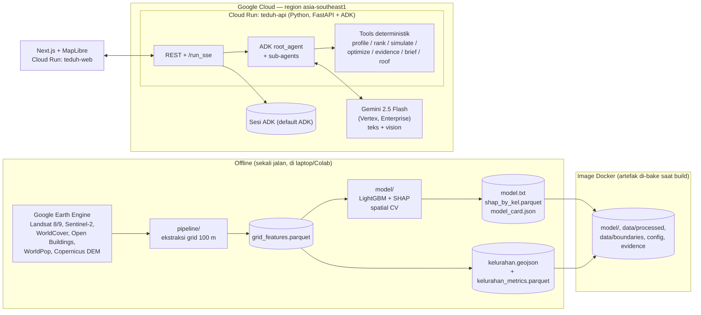

# TEDUH — Dokumen Konsep

> **AI agent yang membantu pemerintah kota memutuskan *di mana* dan *intervensi apa* untuk mendinginkan kawasan paling panas dan paling rentan, lalu menuliskannya menjadi rancangan kebijakan.**

| | |
|---|---|
| Kompetisi | AI Builder Cup 2026 (Hack2skill × Google Cloud) |
| Tema | Sustainability & Social Impact |
| Status | **v1.0 — implementasi selesai (M0–M7), sedang finalisasi evaluasi & submission** · 15 Oktober 2026 |
| Kota pilot | DKI Jakarta daratan — **264 kelurahan**, 75.636 sel grid 100 m |
| Batas submission | **18 Oktober 2026** (cek zona waktu di dashboard Hack2skill) |
| Batas registrasi & tim | **11 Oktober 2026** (sudah lewat) — tim wajib 2–4 orang |

> Catatan status: dokumen ini sudah disinkronkan dengan implementasi aktual. Penyimpangan dari konsep awal dicatat di `docs/DECISIONS.md`; angka terukur terbaru di `docs/SUBMISSION.md` dan `data/model/model_card.json`. Bila angka di sini berselisih dengan `model_card.json` atau `kelurahan_metrics.parquet`, data di repository yang menang.

---

## 1. Ringkasan

Jakarta mencatat intensitas Urban Heat Island (UHI) tertinggi di antara kota besar Indonesia yang diteliti, dengan puncak sekitar 8 °C di musim kemarau. Penelitian pemetaan UHI berbasis machine learning sudah banyak dan akurat, tetapi hasilnya jarang sampai ke dokumen perencanaan seperti RDTR, RPJMD, atau program kelurahan. Alat yang ada (simulasi CFD, optimasi NSGA-II, digital twin) terlalu teknis dan mahal untuk dinas di kota menengah.

**TEDUH** menjembatani celah itu. Perencana cukup bertanya dalam bahasa sehari-hari, misalnya *"Kelurahan mana di Jakarta Timur yang paling panas dan paling rentan, dan dengan anggaran Rp 2 miliar intervensi apa yang paling efektif?"* Agen Gemini kemudian:

1. menarik profil panas tiap kelurahan dari data satelit yang sudah diolah,
2. menghitung indeks kerentanan panas (bahaya × keterpaparan × kepekaan),
3. menjalankan simulasi skenario intervensi (pohon, cool roof, green roof) dengan model ML,
4. menyusun portofolio intervensi dalam batas anggaran,
5. menulis draf policy brief yang setiap angkanya bisa ditelusuri ke data atau literatur.

Warga juga bisa ikut lewat fitur **Cek Atap**: unggah foto atap rumah, lalu Gemini mengenali jenis atap dan merekomendasikan cool roof atau green roof sesuai temuan studi atap tropis Indonesia.

**Status per 15 Okt 2026:** seluruh fitur P0 sudah diimplementasikan dan di-deploy ke Cloud Run. Data nyata (bukan sintetis) terpasang di seluruh jalur: 264 kelurahan, 75.636 sel grid, model LightGBM dengan R² 0,755 pada spatial cross-validation, dan validator asal-usul angka yang memblokir angka karangan. Yang tersisa adalah finalisasi evaluasi, pengumpulan foto uji Cek Atap, dan produksi dokumen submission (lihat §12–§13).

---

## 2. Konteks Kompetisi dan Cara TEDUH Memenuhinya

### 2.1 Syarat wajib

| Syarat | Implementasi TEDUH (status) |
|---|---|
| Model Google AI (Gemini atau Gemma) | **Gemini Flash (`gemini-2.5-flash`)** untuk agen dan vision. Model ID dibaca dari env `TEDUH_MODEL`. **Terverifikasi di Vertex AI:** `gemini-2.5-flash` tersedia di region `asia-southeast1`; `asia-southeast2` (Jakarta) mengembalikan 400 untuk semua model Gemini, dan `gemini-3.8-flash` tidak pernah ada (404) — lihat `DECISIONS.md` 2026-10-12. |
| Platform agentic: Agent Platform, Antigravity, atau AI Studio | **Agent Development Kit (ADK)**, dipakai lewat Vertex Enterprise (`GOOGLE_GENAI_USE_ENTERPRISE=True`). Prototipe prompt di AI Studio. Antigravity dipakai sebagai IDE. |
| Deploy di Cloud Run atau Firebase | Backend agen + API di **Cloud Run `teduh-api`** (region `asia-southeast1`). Frontend Next.js di **Cloud Run `teduh-web`**. |
| Proyek baru selama hackathon | Repo dibuat dari nol mulai 8 Okt 2026. Literatur dan data publik dipakai (belum semua literatur terverifikasi, lihat §7.7). |

### 2.2 Deliverable submission

1. **Proposal PDF**: masalah, visi solusi, manfaat bagi warga, kelayakan, potensi skala.
2. **Prototipe berfungsi** dengan URL publik di Cloud Run.
3. **Video demo maksimal 3 menit** (YouTube/Vimeo/Drive, publik).
4. **Kategori**: Sustainability & Social Impact.

### 2.3 Pemetaan ke kriteria penilaian

| Kriteria (bobot) | Yang ditunjukkan TEDUH |
|---|---|
| **Technical Merit & Gen AI (40%)** | Agen ADK dengan beberapa sub-agen dan tool deterministik. Gemini vision untuk foto atap dengan output terstruktur. Pengecek asal-usul angka (*number provenance check*) sehingga brief tidak berisi angka karangan. Deploy serverless yang bisa diskalakan. |
| **Problem Alignment & Impact (25%)** | Menjawab celah yang disebut literatur: hasil pemetaan tidak masuk kebijakan, alat terlalu teknis, intervensi tidak berpihak ke warga rentan. Output-nya dokumen yang benar-benar bisa dipakai dinas. |
| **Innovation & Creativity (25%)** | Gabungan model ML panas, indeks keadilan panas, simulasi skenario, dan penulisan kebijakan dalam satu percakapan. Laporan warga lewat foto atap. |
| **UX & Solution Design (10%)** | Peta interaktif dan chat berdampingan, slider skenario, brief yang bisa diunduh, antarmuka berbahasa Indonesia (toggle Inggris). |

---

## 3. Masalah

### 3.1 Bukti dari literatur

Angka berikut diambil dari ringkasan NotebookLM "Pemetaan Pulau Panas Perkotaan Berbasis Pembelajaran Mesin" (43 sumber). Hanya 4 dari 10 entri bukti yang sudah dibaca ulang ke naskah aslinya (`verified: true` di `data/evidence/interventions.json`); selebihnya **jangan dikutip di proposal** sampai terverifikasi.

- **Skala masalah.** Jakarta: intensitas UHI permukaan rata-rata 3–6 °C, puncak sekitar 8 °C di musim kemarau. Surabaya 2–5 °C, Makassar sekitar 3 °C. *(Karurung et al., 2025 — ACRS; e-Journal Hamzanwadi)*
- **ML sudah akurat.** Random Forest untuk Jakarta mencapai R² 0,923 (RMSE 0,542 °C). LightGBM untuk Surabaya R² 0,951. Faktor dominan menurut SHAP: curah hujan, CO, kepadatan penduduk, kecepatan angin, NO₂. *(Karurung et al., 2025)*
- **Intervensi bisa diukur dengan model.** Di Kuala Lumpur, simulasi RF menunjukkan kenaikan NDVI 25% menurunkan LST antara −1,4 dan 0,1 °C, dan kenaikan albedo 25% menurunkan −1,2 sampai 0,1 °C. *(Miniandi et al., 2025 — terverifikasi)*
- **Celah implementasi.** Ada jarak antara peta termal resolusi tinggi buatan akademisi dan pemakaiannya di RDTR atau aturan bangunan. Pendanaan, pemeliharaan, dan koordinasi antarlembaga juga terfragmentasi. *(Kumar & Bassill, 2026; review MDPI tentang teknologi riset UHI)*
- **Alat terlalu teknis.** Optimasi spasial butuh keahlian Rhino-Grasshopper, Python, dan algoritma genetika, sehingga sulit dipakai perencana tanpa kalkulator berbasis web. Digital twin seperti Cooling Singapore memerlukan biaya tinggi dan platform tertutup. *(Computational Intelligence in Urban Microclimate Management; Huelva UDT, MDPI)*
- **Ketidakadilan panas.** Warga berpenghasilan rendah dan permukiman padat paling terpapar, sementara kelompok lansia, anak-anak, dan pekerja luar ruang paling berisiko. Literatur menyarankan intervensi diprioritaskan ke wilayah rentan, bukan disebar merata. *(Urban heat dynamics in the tropical global south, ICES 2025)*
- **Kurang partisipasi warga.** Data UHI jarang disajikan dalam bentuk yang mudah dipahami publik, dan warga jarang dilibatkan. *(Kumar & Bassill, 2026)*

### 3.2 Rumusan masalah

> Dinas di kota-kota Indonesia tidak punya alat yang mudah dan murah untuk mengubah data panas perkotaan menjadi keputusan intervensi yang berpihak pada warga rentan dan bisa dipertanggungjawabkan dalam dokumen kebijakan.

---

## 4. Pengguna

| Persona | Kebutuhan | Fitur utama |
|---|---|---|
| **Perencana Bappeda / Dinas Cipta Karya / DLH** | Menentukan lokasi prioritas dan jenis intervensi, menyusun justifikasi anggaran. | Peta prioritas, simulasi skenario, portofolio anggaran, policy brief. |
| **Lurah / Camat / fasilitator kelurahan** | Mengusulkan program penghijauan dalam Musrenbang dengan data. | Profil kelurahan, ringkasan dalam bahasa sederhana. |
| **Warga** | Tahu cara mendinginkan rumah dengan biaya wajar. | Cek Atap (foto → rekomendasi). |
| **Peneliti / analis kebijakan** | Menelusuri asal angka dan metode. | Panel bukti, model card, unduh data. |

Persona utama untuk demo adalah **perencana dinas**. Persona warga melengkapi narasi dampak sosial.

---

## 5. Solusi

### 5.1 Lingkup fitur

**P0 — sudah diimplementasikan (M0–M7)**

1. **Peta Panas & Kerentanan.** Choropleth 264 kelurahan Jakarta dengan lapisan LST rata-rata musim kemarau, anomali terhadap rata-rata kota, Heat Vulnerability Index (HVI), vegetasi (NDVI), dan penduduk rentan.
2. **Chat agen (Bahasa Indonesia, toggle Inggris).** Menjawab pertanyaan, memanggil tool, dan menyorot kelurahan terkait di peta.
3. **Profil Kelurahan.** Nilai panas, peringkat, faktor pendorong utama (SHAP), dan jumlah warga rentan.
4. **Simulasi Skenario.** Pilih intervensi dan intensitasnya, lihat perkiraan ΔLST dari model beserta rentang dari literatur — lewat slider di UI atau langsung lewat chat.
5. **Portofolio Anggaran.** Input anggaran dan wilayah, output daftar paket (kelurahan × intervensi) yang memaksimalkan penurunan panas tertimbang jumlah warga rentan per rupiah, dengan kendala keadilan.
6. **Policy Brief.** Draf terstruktur (Markdown → PDF) dengan sitasi. Setiap angka diberi penanda sumbernya, dan validator menolak angka liar.
7. **Cek Atap.** Unggah foto, Gemini mengklasifikasi atap, lalu sistem memberi rekomendasi berbasis aturan dan bukti. Halaman `/cek-atap` ramah ponsel.
8. **Tentang & Sumber Data.** Halaman `/sumber-data` dengan atribusi dan model card.

**P1 — belum dikerjakan (kalau waktu cukup)**

- Optimasi multi-objektif (NSGA-II via `pymoo`) dengan Pareto front: biaya vs penurunan panas vs pemerataan.
- Peta laporan warga (hasil Cek Atap ditampilkan anonim sebagai titik).
- Perbandingan sebelum/sesudah skenario dalam split-map.
- Ekspor brief ke Google Docs.

**P2 — roadmap, bukan untuk hackathon**

- Laporan panas warga sebagai data lapangan untuk mengoreksi data satelit.
- Cool pavement dengan data jaringan jalan OSM.
- Peramalan musiman dan peringatan panas untuk kader posyandu.
- Multi-kota (Depok, Surabaya, Makassar) dengan transfer learning.
- Surrogate berbasis PINN untuk suhu udara di tingkat pejalan kaki.

### 5.2 Yang sengaja tidak dikerjakan

- Bukan pengganti simulasi CFD/ENVI-met. Hasil simulasi TEDUH bersifat **indikatif** untuk penyaringan awal.
- Model memprediksi **suhu permukaan (LST)**, bukan suhu udara yang dirasakan warga. Batas ini ditampilkan di UI.
- Tidak membuat angka biaya sendiri. Biaya satuan bersumber dari Kepgub DKI 811/2025 atau diberi label "ASUMSI" bila tak ada sumber resmi (lihat §7.6).
- Tidak ada autentikasi pengguna, tidak ada multi-kota, tidak ada basis data riwayat selain sesi.

---

## 6. Arsitektur

### 6.1 Gambaran umum



Alur data penting:

- **Offline → image.** Artefak data & model (±14 MB) **dibakar ke image Docker** lewat `infra/Dockerfile` (`COPY`), bukan diunduh dari GCS saat startup. Ini menghilangkan kredensial + kuota + gagal-unduh dari jalur kritis saat penilaian (`DECISIONS.md` 2026-10-09).
- **Runtime ringan.** Earth Engine tidak pernah dipanggil saat request. Semua fitur dimuat ke memori Cloud Run saat import modul (`api/main.py::warm()`), sehingga request pertama saat dinilai tidak membayar pemuatan 75.636 sel.
- **Brief di disk.** Policy brief ditulis ke `data/briefs/` di dalam container (bukan Firestore) — pengguna mengunduhnya langsung setelah dibuat (`DECISIONS.md` 2026-10-09).
- **Foto atap tidak disimpan.** Dihapus metadata-nya di memori, dianalisis, lalu dibuang — tidak pernah ditulis ke disk atau GCS (`DECISIONS.md` 2026-10-09).

### 6.2 Prinsip desain

1. **Gemini tidak menghitung angka.** Semua angka berasal dari tool Python yang deterministik. Gemini memilih tool, merangkai penalaran, dan menulis narasi.
2. **Setiap angka punya asal-usul.** Tool mengembalikan `facts` dengan ID. Brief memakai penanda `[[F:id]]` yang dirender jadi angka plus catatan kaki. Validator menolak brief yang berisi angka tanpa penanda (lihat §8.4).
3. **Data diolah di depan, aplikasi ringan.** Semua fitur dihitung sekali (offline), disimpan sebagai Parquet/GeoJSON (~14 MB), lalu dibakar ke image. Aplikasi memuat dari `TEDUH_DATA_DIR`, bukan dari jaringan.
4. **Jujur soal ketidakpastian.** Hasil model selalu ditampilkan bersama rentang literatur dan label "indikatif".
5. **Bahasa Indonesia lebih dulu.** UI dan jawaban agen dalam Bahasa Indonesia; toggle Inggris ada untuk juri.

Penyimpangan yang sudah diputuskan dan alasannya tercatat di `docs/DECISIONS.md`.

---

## 7. Data dan Model

### 7.1 Wilayah dan unit analisis

- **Wilayah:** DKI Jakarta daratan (tanpa Kepulauan Seribu).
- **Grid:** 100 m × 100 m, sejajar dengan grid WorldPop. **75.636 sel** (estimasi awal ~66 ribu ternyata kasar — `DECISIONS.md` 2026-10-09).
- **Unit kebijakan:** **264 kelurahan** (bukan ~267 seperti perkiraan awal). Nilai sel diagregasi ke kelurahan (rata-rata tertimbang luas, dan tertimbang penduduk untuk metrik paparan).
- **Batas administrasi:** HDX COD-AB Indonesia level 4 (P-code BPS, CC BY-IGO). Tervalidasi: total penduduk WorldPop setelah diklip ke 264 kelurahan = 11.070.515 vs Dukcapil Semester I 2025 = 11.010.514, selisih **0,54%**.

### 7.2 Dataset (Earth Engine)

Data final ada di `data/processed/grid_features.parquet` (75.636 sel, ~24 kolom) dan `data/processed/kelurahan_metrics.parquet` (264 kelurahan, 32 kolom).

| Variabel | Dataset (EE ID) | Resolusi | Olahan |
|---|---|---|---|
| LST (target) | `LANDSAT/LC08/C02/T1_L2`, `LANDSAT/LC09/C02/T1_L2` | 30 m (TIRS di-resample) | `ST_B10 × 0.00341802 + 149.0` → K → °C. Mask awan pakai `QA_PIXEL`. Median musim kemarau Jun–Sep 2023–2025. Sel dengan `< 20` observasi bersih diberi `lst_quality = "low"`. |
| Albedo | Landsat 8/9 SR (band yang sama) | 30 m | SR `× 0.0000275 − 0.2`, albedo broadband formula Liang (2001). |
| NDVI, NDBI, NDWI | `COPERNICUS/S2_SR_HARMONIZED` + `GOOGLE/CLOUD_SCORE_PLUS/V1/S2_HARMONIZED` | 10 m | Median periode yang sama dengan LST. |
| Fraksi pohon, bangunan, air | `ESA/WorldCover/v200` | 10 m | Persentase tiap kelas per sel 100 m. `tree_frac` = kelas pohon + mangrove; `built_frac` = 50; `water_frac` = 80 + 90. |
| Tinggi & kepadatan bangunan | `GOOGLE/Research/open-buildings-temporal/v1` (tahun 2023) | 4 m efektif | Rata-rata `building_height`, fraksi `building_presence > 0.5` sebagai fraksi atap. |
| Penduduk | `projects/sat-io/open-datasets/WORLDPOP/pop` (Global2 2025) | 100 m | Jumlah jiwa per sel. Fallback `WorldPop/GP/100m/pop` (2020). |
| Penduduk rentan | `projects/sat-io/open-datasets/WORLDPOP/agesex` (2025) | 100 m | Jumlah usia < 5 dan ≥ 65. |
| Elevasi | `COPERNICUS/DEM/GLO30` | 30 m | Rata-rata per sel. Rentang plausibel (−15, 200) m (Sunter memang di bawah laut). |
| Jarak ke pantai | turunan dari mask air/garis pantai | — | Kilometer (komponen air terhubung terbesar yang menyentuh tepi utara = Teluk Jakarta). |

> **NO₂ tidak dipakai.** Band `COPERNICUS/S5P/OFFL/L3_NO2` nol di seluruh raster (min = max = 0), jadi dibuang dari grid dan dari fitur model (`DECISIONS.md` 2026-10-09). Dicatat sebagai keterbatasan.

> Katalog lengkap (lisensi, sitasi, validasi suhu udara, harga satuan): `docs/DATA_SOURCES.md`. Status apa yang sudah/belum ada: `docs/DATA_STATUS.md`.

> Catatan: Karurung et al. memakai panel bulanan sehingga curah hujan dan polutan dominan. TEDUH memakai **penampang spasial** satu musim, jadi pendorongnya didominasi faktor permukaan yang **bisa diintervensi**. Ini sengaja, karena tujuannya adalah keputusan tata ruang.

Kolom `grid_features.parquet`: `cell_id, kel_id, geometry (centroid), lst_c, lst_n, lst_quality, albedo, ndvi, ndbi, ndwi, tree_frac, built_frac, water_frac, roof_frac, bldg_h_mean, pop, pop_u5, pop_65p, elev_m, dist_coast_km`.

### 7.3 Model panas

- **Algoritma:** LightGBM regression. Baseline: regresi linear.
- **Fitur (12):** `albedo, ndvi, ndbi, ndwi, tree_frac, built_frac, water_frac, roof_frac, bldg_h_mean, elev_m, dist_coast_km, pop`. **Tidak** memakai koordinat lat/lon sebagai fitur.
- **Monotonic constraints** (pengetahuan fisika sederhana): LST turun saat `ndvi`, `albedo`, `tree_frac`, `water_frac` naik (−1); LST naik saat `built_frac` dan `ndbi` naik (+1). Hasilnya, simulasi skenario selalu searah dengan fisika.
- **Validasi:** spatial block cross-validation (blok 1000 m, `GroupKFold` 5 lipatan) agar tidak bocor karena autokorelasi spasial.
- **Hasil terukur (`data/model/model_card.json`):** **R² 0,755 (rentang lipatan 0,723–0,776)**, RMSE 1,24 °C, MAE 0,94 °C, pada 75.603 sel latih. Baseline linear R² 0,686 — LightGBM unggul 0,069. Target awal R² ≥ 0,75 **tercapai** (rata-rata lipatan), tetapi laporkan sebagai **rentang**, bukan angka tunggal.
- **Cek independen:** WorldPop vs Dukcapil 0,54%; suhu udara BMKG vs GHCN selisih 0,14 °C.
- **Penjelasan:** SHAP `TreeExplainer`. Nilai SHAP per kelurahan di `shap_by_kel.parquet` untuk fitur "faktor pendorong".
- **Model card:** `model_card.json` berisi periode data, metrik CV per lipatan, fitur, batasan, versi. Ditampilkan di UI.

### 7.4 Heat Vulnerability Index (HVI)

Kerangka risiko IPCC: bahaya × keterpaparan × kerentanan. Semua komponen dinormalisasi ke persentil (0–1) **dalam kota** (bukan per-scope).

| Komponen | Simbol | Rumus |
|---|---|---|
| Bahaya | H | persentil `lst_c` |
| Keterpaparan | E | persentil kepadatan `pop` |
| Kepekaan | S | persentil `(pop_u5 + pop_65p) / pop` |
| Kurangnya kapasitas adaptif | A | `1 −` persentil `tree_frac` |

`HVI = H × (wE·E + wS·S + wA·A)`, bobot default `wE=0,4; wS=0,3; wA=0,3` (`config/hvi.yaml`), bisa diubah dari UI dan dicatat di brief.

**Penting:** `rank_priority_areas` memakai komponen H/E/S/A yang **tersimpan se-kota** di `kelurahan_metrics.parquet`, bukan dihitung ulang per-scope. Ini memastikan peringkat yang dilaporkan chat selalu sama dengan warna peta (`DECISIONS.md` 2026-10-13).

Metrik pendamping: **warga rentan terpapar** = jumlah `pop_u5 + pop_65p` di sel dengan H ≥ 0,8.

### 7.5 Mesin skenario

Intervensi diterjemahkan menjadi perubahan fitur, lalu model memprediksi LST baru. Semua konstanta ada di `config/scenario.yaml` dan diberi label sumber, `data:grid_features@v1`, atau `ASUMSI`.

| Intervensi | Parameter | Perubahan fitur |
|---|---|---|
| `tree_planting` | `canopy_increase_pp` (poin persen luas sel), dibatasi lahan non-bangunan non-air | `tree_frac += Δ`; `ndvi += Δ × (ndvi_tree − ndvi)` dengan `ndvi_tree = 0,6450` (median NDVI sel `tree_frac > 0,8`, terkalibrasi dari 2.282 sel — `data:grid_features@v1`) |
| `cool_roof` | `adoption_rate` (porsi luas atap) | `albedo += roof_frac × adoption × (α_cool − α_roof)`; `α_cool = 0,65` (setelah penuaan), `α_roof = 0,15` — **ASUMSI**, cek literatur |
| `green_roof` | `adoption_rate` pada porsi atap datar (`flat_roof_share = 0,2` — ASUMSI) | `ndvi` naik ke `ndvi_green = 0,35` (ASUMSI, sengaja jauh di bawah `ndvi_tree`), `albedo` mendekati `albedo_green = 0,2` |

Output per kelurahan: ΔLST rata-rata, ΔLST tertimbang penduduk, jumlah warga rentan yang berada di sel dengan ΔLST ≤ −0,5 °C, luas intervensi (m²), dan biaya.

**Flag ekstrapolasi:** dihitung **per sel**, hanya meninjau fitur yang benar-benar digerakkan intervensi, dan fraksi tutupan lahan (`tree_frac`, `built_frac`, `water_frac`, `roof_frac`) dikecualikan karena jenuh di 1,0. Kalau fitur hasil skenario melewati persentil 99 data latih, tool mengembalikan `extrapolation: true` (`DECISIONS.md` 2026-10-10).

**Pembanding literatur** selalu disertakan dari basis bukti (§7.7). Contoh: model memprediksi −0,8 °C, literatur Kuala Lumpur untuk +25% NDVI menyebut −1,4 sampai 0,1 °C.

### 7.6 Optimasi portofolio

- **Kandidat:** (kelurahan × intervensi × level rendah/sedang/tinggi).
- **Nilai:** `Σ (pop_u5 + pop_65p + λ·pop) × (−ΔLST)` per kandidat.
- **Biaya:** luas × harga satuan dari `config/costs.yaml`. Sumber harga: **Kepgub DKI 811/2025** untuk pohon (Tabebuya 2.702.703/tree), relokasi/proxy tanam (1.950.000/tree), dan perawatan (5.396.761/orang-bulan). Cool roof (95.000/m²) dan green roof (600.000/m²) **tetap ASUMSI** — nol item reflektif/green roof di Kepgub (`DECISIONS.md` 2026-10-09).
- **Solver:** Google **OR-Tools CP-SAT** (knapsack berganda). Kendala: anggaran total, maksimal satu level per (kelurahan, intervensi), dan **kendala keadilan** — minimal 60% anggaran untuk kelurahan kuintil HVI teratas (`equity_share_min` di `config/costs.yaml`).
- **P1:** NSGA-II (`pymoo`) untuk Pareto front biaya vs pendinginan vs pemerataan — belum dikerjakan.

### 7.7 Basis bukti intervensi

Disimpan di `data/evidence/interventions.json`. Setiap entri: `id, intervention, metric, value_min, value_max, unit, context, source_*, year, url_or_doi, verified`. Hanya entri `verified: true` yang boleh dikutip agen maupun proposal (dipaksa oleh `tools/evidence.py` dan `tools/roof.py`).

**Status verifikasi: 4 dari 10 entri `verified: true`.** Yang terverifikasi:

| Intervensi | Metrik | Temuan | Sumber |
|---|---|---|---|
| Penghijauan (NDVI +25%) | LST wilayah | **−1,4 s.d. 0,1 °C** | Miniandi et al. 2025, Kuala Lumpur — `verified` |
| Albedo +25% | LST wilayah | **−1,2 s.d. 0,1 °C** | Miniandi et al. 2025, Kuala Lumpur — `verified` |
| Cool roof | **suhu permukaan atap** | hingga −11,58 °C; fluks panas −95%; hemat energi **hingga 55%** (batas bawah 36% tidak terkonfirmasi) | Journal UII (JARDS) 2024 — `verified` |
| Green roof | **suhu permukaan atap** | hingga −13,14 °C; fluks panas −91%; hemat energi ~60% | Journal UII (JARDS) 2024 — `verified` |

> **Peringatan metrik (load-bearing):** angka cool/green roof Indonesia (−11,58 / −13,14 °C) mengukur **suhu permukaan atap bangunan**, bukan pendinginan wilayah (LST). Memakainya sebagai pendinginan kelurahan akan melebihkan dampak ±10×. `metric` di setiap entri menamai apa yang diukur dan di mana.

Belum terverifikasi (jangan dikutip): cool pavement (SNTI/ICES), meta-review penghijauan kota (−1,5…−4,5 °C suhu udara — patut dicurigai), green curtain Tokyo, paket terkoordinasi Cooling Singapore (−7 °C hotspot), aturan 5-10-20 Melbourne, daftar spesies lokal Bandung. Lihat `interventions.json` untuk catatan verifikasi per entri.

---

## 8. Desain Agen (ADK)

### 8.1 Struktur agen

```
teduh_coordinator  (root_agent, LlmAgent, Gemini Flash)
├── heat_analyst          → find_area, get_area_profile, rank_priority_areas, explain_drivers
├── intervention_planner  → simulate_intervention, optimize_portfolio, get_evidence
├── policy_writer         → get_session_facts, render_policy_brief
└── roof_inspector        → analyze_roof_photo, recommend_roof_action
```

Koordinator sengaja **tidak memegang tool analisis sendiri**, supaya tidak menjawab langsung dan melewati instruksi spesialis yang membawa peringatan metrik.

Fallback kalau routing multi-agen tidak stabil: **satu `LlmAgent` dengan semua tool** lewat env `TEDUH_SINGLE_AGENT=1`. Desain tool tidak berubah (kontraknya identik). Lihat `teduh_agent/agent.py`.

### 8.2 Kontrak tool

Semua tool berupa fungsi Python bertipe dengan docstring jelas (ADK memakai docstring sebagai deskripsi tool). Semua mengembalikan `dict` dengan kunci `facts: list[Fact]` dan `map_highlight: list[kel_id]` (opsional) untuk menyorot peta.

```python
Fact = {"id": str, "label": str, "value": float | int | str, "unit": str,
        "source": "data:grid_features@v1" | "model:lgbm@v1" | "evidence:<id>" | "assumption:<key>"}
```

| Tool | Input | Output utama |
|---|---|---|
| `find_area(query: str)` | nama kelurahan/kecamatan/kota (fuzzy) | daftar `kel_id`, nama, kecamatan, kota |
| `get_area_profile(kel_id: str)` | — | LST rata-rata, anomali (vs 41,84 °C), peringkat, HVI dan komponennya, NDVI, fraksi pohon/bangunan, penduduk, warga rentan |
| `rank_priority_areas(scope: str, top_k: int = 10, weights: dict \| None = None)` | scope = kota/kecamatan/"all" | daftar kelurahan urut HVI + alasan singkat |
| `explain_drivers(kel_id: str)` | — | 3–5 fitur SHAP teratas dengan arah dan besarnya (°C) |
| `simulate_intervention(kel_ids: list[str], interventions: list[{type, level \| params}])` | — | ΔLST per kelurahan, ΔLST tertimbang penduduk, warga rentan terdampak, luas, biaya, `extrapolation`, rentang literatur |
| `optimize_portfolio(scope: str, budget_idr: int, equity_share: float = 0.6, allowed: list[str] \| None = None)` | — | daftar paket terpilih, total biaya, total ΔLST tertimbang, porsi untuk kuintil HVI teratas |
| `get_evidence(intervention: str)` | — | entri basis bukti **terverifikasi** dengan sitasi |
| `analyze_roof_photo(image_uri: str)` | foto | JSON terstruktur dari Gemini vision (§8.5) |
| `recommend_roof_action(roof: dict)` | output tool di atas | rekomendasi berbasis aturan + bukti + catatan keselamatan |
| `get_session_facts()` | — | semua `facts` yang sudah muncul di sesi |
| `render_policy_brief(draft_markdown: str)` | draf dengan penanda `[[F:id]]` | brief final (Markdown + PDF) atau daftar error validasi |

### 8.3 Instruksi sistem (inti)

- Jawab dalam Bahasa Indonesia yang jelas untuk pegawai pemerintah daerah, kecuali pengguna memakai bahasa lain.
- **Jangan pernah menulis angka yang tidak berasal dari hasil tool.** Kalau data tidak ada, katakan tidak ada.
- Selalu sebut bahwa ΔLST adalah suhu permukaan dan bersifat indikatif.
- Saat merekomendasikan intervensi, sertakan rentang literatur dari `get_evidence`.
- Prioritaskan warga rentan. Jika pengguna meminta prioritas yang mengabaikan keadilan, tetap tampilkan dampaknya terhadap kelompok rentan.
- Jangan membuat harga. Pakai `config/costs.yaml`. (Atas permintaan pemilik proyek 9 Okt, brief **tidak** merender disclaimer "harga ini asumsi" — tetapi `source:` tetap melekat di tiap angka biaya agar lolos validator, lihat `DECISIONS.md` 2026-10-09.)

### 8.4 Pengecek asal-usul angka (number provenance check)

1. `policy_writer` menulis draf dengan penanda, contoh: `Kelurahan Kampung Melayu memiliki LST rata-rata [[F:kel_3175031001.lst]].`
2. `render_policy_brief` mengganti penanda dengan nilai + satuan dan membuat catatan kaki sumber.
3. Validator regex mencari angka di teks **di luar** penanda. Pengecualian: tahun (19xx/20xx), nomor bagian, nomor peraturan dalam daftar putih. Kalau ada angka liar, tool mengembalikan error dan agen menulis ulang (maksimal 2 kali).
4. UI menampilkan lencana "Semua angka terverifikasi (n fakta)". Ini poin jual untuk juri dan pengguna pemerintah.

Struktur brief: Ringkasan Eksekutif · Kondisi Panas Wilayah · Kelompok Rentan · Opsi Intervensi & Perkiraan Dampak · Rekomendasi Portofolio & Anggaran · Keterkaitan dengan Dokumen Perencanaan (RDTR/RPJMD/RTH 30%) · Keterbatasan · Sumber.

### 8.5 Cek Atap (Gemini vision)

`analyze_roof_photo` memanggil Gemini dengan `response_schema`:

```json
{
  "roof_visible": true,
  "roof_form": "flat | pitched | mixed | unknown",
  "material": "clay_tile | concrete_tile | metal_sheet | concrete_slab | asbestos_cement | other | unknown",
  "color_tone": "light | medium | dark",
  "condition": "good | worn | damaged | unknown",
  "shade_from_trees": "none | partial | heavy",
  "confidence": 0.0,
  "notes": "string"
}
```

Aturan `recommend_roof_action` (tidak memakai LLM):

| Kondisi | Rekomendasi |
|---|---|
| `pitched` + genteng/metal | Cat cool roof (pemantul panas). Prioritas tinggi untuk metal gelap. |
| `flat` + `concrete_slab` | Green roof jika struktur memungkinkan (sarankan cek beban ke tenaga ahli), atau cat cool roof. |
| `asbestos_cement` | **Jangan diamplas, dipotong, atau dibor.** Sarankan konsultasi tenaga profesional. Opsi aman: peneduh pohon atau green curtain. |
| `shade_from_trees: heavy` | Manfaat tambahan kecil. Sarankan menjaga pohon yang ada. |
| `confidence < 0,6` atau `roof_visible: false` | Minta foto ulang dengan panduan sudut. |

Privasi: EXIF dihapus dengan membangun ulang piksel ke wadah baru (bukan sekadar hapus tag), **foto tidak pernah disimpan ke disk atau GCS**, dan lokasi paling detail setingkat kelurahan (opsional, atas persetujuan). Jalur `/api/roof` memeriksa tipe, ukuran, dan lokasi **sebelum** piksel diproses atau dikirim ke Gemini.

---

## 9. Pengalaman Pengguna

### 9.1 Tata letak

```
┌──────────────────────────────────────────────────────────────────────┐
│ TEDUH  │ Lapisan: [LST] [HVI] [NDVI] [Penduduk rentan]   │ ID/EN │ ⓘ │
├───────────────────────────────────────────┬──────────────────────────┤
│                                           │  Chat agen               │
│            PETA (MapLibre)                │  ─────────────────────   │
│   choropleth kelurahan, sorotan dari      │  pesan + kartu hasil     │
│   agen, klik → panel profil               │  (profil, skenario,      │
│                                           │   portofolio, brief)     │
├───────────────────────────────────────────┤                          │
│ Panel skenario: [Pohon ▮▮▯] [Cool roof ▮▯▯]│  [ketik pertanyaan…] 📎 │
│ [Green roof ▯▯▯]  Anggaran: Rp ____        │                          │
└───────────────────────────────────────────┴──────────────────────────┘
```

- Mobile: peta di atas, chat sebagai bottom sheet. Cek Atap punya halaman sendiri (`/cek-atap`) yang ramah ponsel.
- Kartu hasil di chat bisa diklik untuk menyorot peta.
- Setiap angka di kartu punya tooltip sumber.
- Tombol "Unduh brief (PDF)" dan "Salin ringkasan".
- Toggle ID/EN diterapkan tiga lapis: UI statis (tabel i18n), jawaban agen (lang lewat `state_delta` + `InstructionProvider`), dan output tool (`note_key` diterjemahkan web) — `DECISIONS.md` 2026-10-14.

### 9.2 Contoh percakapan

> **Pengguna:** Kelurahan mana di Jakarta Timur yang paling perlu diprioritaskan untuk penanganan panas?
>
> **TEDUH:** *(memanggil `rank_priority_areas`)* Lima kelurahan dengan HVI tertinggi … *(peta menyorot 5 kelurahan)* Faktor utamanya adalah fraksi bangunan tinggi dan tutupan pohon rendah *(memanggil `explain_drivers`)* …
>
> **Pengguna:** Kalau di dua teratas kita lakukan cool roof 50% dan tambah kanopi 10%, turun berapa?
>
> **TEDUH:** *(memanggil `simulate_intervention` + `get_evidence`)* Perkiraan model … Sebagai pembanding, studi di Kuala Lumpur …
>
> **Pengguna:** Anggaran kami Rp 2 miliar. Susun paketnya dan buatkan brief untuk Bappeda.
>
> **TEDUH:** *(memanggil `optimize_portfolio` → `render_policy_brief`)* Brief siap. Semua 23 angka terverifikasi. [Unduh PDF]

---

## 10. Naskah Video Demo (≤ 3 menit)

| Waktu | Adegan | Pesan |
|---|---|---|
| 0:00–0:20 | Foto jalan Jakarta siang hari, peta LST | "Jakarta bisa 8 °C lebih panas dari pinggirannya. Peta panasnya sudah ada. Kebijakannya belum." |
| 0:20–0:50 | Tanya kelurahan prioritas di Jakarta Timur, peta menyorot | Agen memahami pertanyaan biasa dan memakai data satelit. |
| 0:50–1:30 | Faktor pendorong (SHAP), simulasi cool roof + pohon, rentang literatur | Bisa dijelaskan, bisa disimulasikan, jujur soal ketidakpastian. |
| 1:30–2:00 | Optimasi anggaran Rp 2 M dengan kendala keadilan | Anggaran diarahkan ke warga paling rentan. |
| 2:00–2:25 | Policy brief, lencana "angka terverifikasi", unduh PDF | Dari data ke dokumen kebijakan dalam hitungan menit, tanpa angka karangan. |
| 2:25–2:45 | Warga memotret atap di ponsel, keluar rekomendasi | Warga ikut terlibat. |
| 2:45–3:00 | Diagram arsitektur: Gemini, ADK, Cloud Run, Earth Engine, OR-Tools | Bisa diterapkan di kota lain cukup dengan mengganti batas wilayah. |

Naskah demo aktual: `docs/superpowers/plans/` dan `video/`.

---

## 11. Stack dan Struktur Repo

### 11.1 Stack

| Lapisan | Pilihan |
|---|---|
| Data | Earth Engine Python API (offline), geopandas, pyarrow (grup `pipeline`, tidak di image runtime) |
| ML | LightGBM, SHAP, scikit-learn (CV), OR-Tools CP-SAT, pymoo (P1) |
| Agen | `google-adk` (Python), `google-genai`, Gemini Flash |
| Backend | Python 3.12, FastAPI (via `google.adk.cli.fast_api.get_fast_api_app` + router sendiri), uv |
| PDF | Markdown → HTML → WeasyPrint (Pango/Cairo dipasang di Dockerfile) |
| Frontend | Next.js (App Router) + TypeScript + Tailwind + MapLibre GL JS, basemap gratis (mis. OpenFreeMap) dengan atribusi |
| Penyimpanan | Artefak data/model **dibakar ke image Docker**; sesi ADK pakai penyimpanan default ADK; brief di disk (`data/briefs/`); foto atap tidak disimpan |
| Deploy | Cloud Run `teduh-api` + `teduh-web`, region **`asia-southeast1`** (Singapura — `asia-southeast2` tidak melayani Gemini). Build via Cloud Build (`infra/cloudbuild.yaml`). Secret Manager untuk kunci. |
| Lokasi model | Gemini 2.5 Flash di Vertex AI, region `asia-southeast1` (endpoint regional). |

Env var penting (lihat `.env.example`):

```bash
GOOGLE_CLOUD_PROJECT=...
GOOGLE_CLOUD_LOCATION=asia-southeast1
GOOGLE_GENAI_USE_ENTERPRISE=True
TEDUH_MODEL=gemini-2.5-flash
TEDUH_DATA_DIR=               # direktori artefak (kosong = root repo; dipakai tes & container)
TEDUH_SINGLE_AGENT=0          # 1 = fallback satu agen
TEDUH_WEB_ORIGIN=             # daftar origin CORS, dipisah koma
TEDUH_MIN_INSTANCES=0         # 1 selama periode penilaian 19 Okt - 6 Nov
TEDUH_LLM_BACKEND=            # opsional: "openai" untuk dev lokal tanpa kredensial Gemini
```

### 11.2 Struktur repo

```
teduh/
├── CLAUDE.md
├── docs/
│   ├── CONCEPT.md            ← dokumen ini (sumber kebenaran desain)
│   ├── DECISIONS.md          ← penyimpangan yang sudah diputuskan beserta alasannya
│   ├── PRD.md                ← persyaratan yang bisa diterima/ditolak
│   ├── DATA_SOURCES.md       ← katalog data, lisensi, sitasi, harga
│   ├── DATA_STATUS.md        ← apa yang sudah/belum ada di disk
│   ├── SUBMISSION.md         ← checklist & angka terukur untuk submission
│   ├── model_card.md
│   └── proposal/             ← sumber PDF proposal
├── config/
│   ├── scenario.yaml         ← konstanta skenario (berlabel sumber/data/ASUMSI)
│   ├── costs.yaml            ← harga satuan (Kepgub 811/2025 + ASUMSI)
│   └── hvi.yaml              ← bobot HVI default
├── pipeline/                 ← offline, Earth Engine
│   ├── gee_extract.py
│   ├── build_grid.py
│   ├── aggregate_kelurahan.py
│   ├── fetch_public.py
│   ├── verify_costs.py       ← cek harga ke text layer PDF Kepgub
│   ├── crosscheck_bmkg.py
│   └── strip_exif.py
├── model/
│   ├── config.py             ← konstanta konfigurasi yang dipakai runtime
│   ├── hvi.py
│   ├── train.py              ← LightGBM + spatial CV + monotonic constraints
│   ├── explain.py            ← SHAP
│   └── scenario.py           ← mesin skenario (dipakai tool)
├── data/
│   ├── boundaries/           ← kelurahan.geojson
│   ├── processed/            ← grid_features.parquet, kelurahan_metrics.parquet
│   ├── model/                ← model.txt, model_card.json, shap_by_kel.parquet
│   ├── briefs/               ← output render_policy_brief (runtime)
│   ├── roof_test/            ← foto uji Cek Atap (0 dari 30 per 15 Okt)
│   └── evidence/interventions.json
├── teduh_agent/              ← paket ADK (agent.py berisi root_agent)
│   ├── agent.py
│   ├── llm.py                ← resolve_model() + backend dev [OI]-compatible
│   ├── store.py              ← muat artefak ke memori
│   ├── sub_agents/           ← heat_analyst, intervention_planner, policy_writer, roof_inspector
│   ├── tools/                ← areas, scenario_tools, optimize, evidence, roof, brief
│   └── prompts/
├── api/
│   ├── main.py               ← FastAPI: get_fast_api_app + /api router + warm()
│   ├── routes.py             ← endpoint REST (memanggil tool yang sama dgn agen)
│   └── schemas.py
├── web/                      ← Next.js (app router: /, /cek-atap, /sumber-data)
├── infra/
│   ├── Dockerfile
│   ├── cloudbuild.yaml
│   ├── deploy_api.sh
│   └── firebase.json
└── tests/
    ├── test_scenario.py
    ├── test_provenance.py
    ├── test_optimize.py
    ├── test_areas.py
    ├── test_roof.py
    └── eval/golden_questions.yaml
```

### 11.3 Endpoint REST (di luar endpoint ADK)

| Method | Path | Fungsi |
|---|---|---|
| GET | `/api/health` | readiness + apa yang ter-load (jumlah kelurahan/sel, model, SHAP) |
| GET | `/api/kelurahan` | GeoJSON ringan + metrik untuk peta |
| GET | `/api/kelurahan/{kel_id}` | profil lengkap + driver SHAP |
| POST | `/api/simulate` | skenario langsung dari slider (tanpa LLM) |
| POST | `/api/optimize` | portofolio langsung dari form |
| POST | `/api/roof` | unggah foto → klasifikasi + rekomendasi |
| GET | `/api/brief/{brief_id}` | brief Markdown/PDF |
| GET | `/api/model-card` | metrik dan batasan model |

Chat memakai endpoint ADK (`/run_sse`) dengan streaming. Semua handler REST memanggil **fungsi tool yang sama** dengan yang dipanggil agen, supaya UI dan agen tidak pernah berselisih tentang angka yang sama.

---

## 12. Rencana Kerja → Status Implementasi

Rencana awal 11 hari (3 orang) sekarang sudah dikerjakan hampir seluruhnya. Status per mileston:

| Milestone | Isi | Status |
|---|---|---|
| M0 Kerangka | repo, dependency, Dockerfile, ADK "hello tool" di Cloud Run | ✅ selesai |
| M1 Data | grid + kelurahan + HVI nyata | ✅ selesai (75.636 sel, 264 kelurahan) |
| M2 Model | LightGBM + spatial CV + SHAP + model card | ✅ selesai (R² 0,755) |
| M3 Tools | semua tool CONCEPT §8.2 + unit test | ✅ selesai |
| M4 Agen | root + sub-agen + instruksi sistem + fallback satu agen | ✅ selesai |
| M5 Brief | Markdown → PDF + validator provenance | ✅ selesai |
| M6 Cek Atap | Gemini vision + aturan rekomendasi | ✅ selesai (fitur jalan; angka akurasi belum) |
| M7 Frontend | peta, chat SSE, panel skenario, `/cek-atap`, `/sumber-data` | ✅ selesai |
| M8 Evaluasi & deploy | golden questions, `min-instances=1`, halaman sumber | 🔄 berjalan (deploy selesai; evaluasi sebagian) |

Sisa pekerjaan (15 Okt → 18 Okt):

1. **Evaluasi:** naikkan akurasi pemilihan tool (sekarang 65%), turunkan latensi p50 (9,4 s), dan ukur akurasi Cek Atap bila 30 foto terkumpul.
2. **Angka proposal:** isi dari `SUBMISSION.md`, bukan dari target CONCEPT.
3. **Konten:** proposal PDF + video ≤ 3 menit + unggah publik.
4. **Submission pagi 18 Okt.**

Titik keputusan yang sudah terlewati: batas kelurahan (HDX COD-AB, aman), multi-agen (stabil, fallback siap), fitur yang belum jalan (dikeluarkan dari demo). Kota pilot tetap Jakarta.

---

## 13. Evaluasi dan Pengujian

| Aspek | Cara ukur | Target | Hasil terukur (15 Okt) |
|---|---|---|---|
| Model panas | Spatial block CV | R² ≥ 0,75 | ✅ **0,755 (lipatan 0,723–0,776)**, RMSE 1,24 °C |
| Arah fisika skenario | Unit test tambah pohon/albedo → ΔLST ≤ 0 | 100% lulus | ✅ hijau |
| Provenance | Semua brief di golden set lolos validator | 100% | ✅ hijau |
| Pemilihan tool | 20 golden questions, cek tool yang dipanggil | ≥ 90% benar | ⚠️ **65% (13/20)** — di bawah target, jangan dikutip sebagai capaian |
| Cek Atap | 30 foto berlabel manual | `roof_form` ≥ 85%, `material` ≥ 70% | ⚠️ **belum terukur** (0/30 foto) |
| Latensi | p50 per jawaban chat | < 8 detik | ⚠️ **9,4 s** — di atas target |
| Optimasi | Kendala anggaran & keadilan terpenuhi | 100% | ✅ hijau |
| Cakupan tes | `pytest --cov` | ≥ 80% | 262+ test lulus (lihat `DATA_STATUS.md`) |

Catatan runner: 2 dari 20 golden questions (foto atap + lanjutkan brief multi-giliran) butuh runner multimodal/multi-giliran yang belum ada, jadi target 90% diukur terhadap 18 pertanyaan yang bisa diujikan runner teks (`DECISIONS.md` 2026-10-09).

---

## 14. Risiko dan Mitigasi

| Risiko | Status | Mitigasi (yang dijalankan) |
|---|---|---|
| Tim belum terbentuk sebelum 11 Okt | ✅ lewat | — |
| Awan tebal di citra termal tropis | ✅ tertangani | Median multi-tahun Jun–Sep 2023–2025; sel `< 20` observasi diberi `lst_quality = "low"` dan dikecualikan dari latih |
| Ekspor Earth Engine lambat/kuota | ✅ lewat | Pipeline dijalankan offline; hasil antara disimpan; band NO₂ yang nol dibuang |
| Batas kelurahan tidak rapi | ✅ lewat | HDX COD-AB; tervalidasi ke Dukcapil (0,54%) |
| Gemini mengarang angka | 🔒 aktif | Tool deterministik + validator provenance |
| Model korelasional dibaca kausal | 🔒 aktif | Monotonic constraints, label "indikatif", pembanding literatur, flag ekstrapolasi per sel |
| Harga satuan tidak akurat | 🔒 aktif | Kepgub 811/2025 untuk pohon/perawatan; cool/green roof tetap ASUMSI (celah terbesar tersisa — satu penawaran vendor memperbaikinya) |
| Cold start saat dinilai | 🔒 aktif | `min-instances=1` 19 Okt–6 Nov; artefak dimuat saat import modul |
| Biaya API membengkak saat penilaian | 🔒 aktif | Model Flash, batas token per sesi, billing alert |
| Foto atap memuat data pribadi | 🔒 aktif | EXIF dibuang total, foto **tidak disimpan**, lokasi maks. kelurahan |
| Multi-agen tidak stabil | 🔒 siap | `TEDUH_SINGLE_AGENT=1` |
| Sesi/brief hilang saat instance ganti | diterima | `max-instances` kecil; brief diunduh langsung; sesi default ADK |

---

## 15. Dampak dan Skala

- **Pengguna langsung:** Bappeda dan dinas teknis di 500+ kabupaten/kota Indonesia yang wajib menyusun RTH dan RDTR.
- **Penerima manfaat:** warga rentan di kawasan terpanas (lansia, balita, pekerja luar ruang).
- **Replikasi:** pipeline hanya butuh batas wilayah dan periode. Semua dataset global (Landsat, Sentinel, WorldCover, Open Buildings untuk Global South, WorldPop), sehingga bisa diterapkan di kota Asia Tenggara lain.
- **Jalur adopsi:** uji coba bersama satu Pemkot (misalnya Depok atau DKI) setelah hackathon. Brief bisa langsung dipakai sebagai lampiran usulan Musrenbang atau kajian teknis RTH.
- **Kaitan SDG:** SDG 11 (kota berkelanjutan), SDG 13 (aksi iklim), SDG 3 (kesehatan).

---

## 16. Checklist Submission

Lihat `docs/SUBMISSION.md` untuk status terkini tiap item. Ringkasnya:

- [ ] Tim 2–4 orang terdaftar (batas 11 Okt 2026)
- [ ] URL prototipe publik (Cloud Run) bisa dibuka tanpa login
- [ ] Video ≤ 3 menit, publik, ada narasi atau teks
- [ ] Proposal PDF: masalah, solusi, manfaat warga, kelayakan, skala, arsitektur, tim
- [ ] Kategori: Sustainability & Social Impact
- [ ] Halaman "Tentang & Sumber Data" (`/sumber-data`) di aplikasi
- [ ] Model card dan batasan tercantum
- [ ] Semua angka literatur di proposal `verified: true` di `interventions.json`
- [ ] `min-instances=1` aktif 19 Okt – 6 Nov
- [ ] Tidak ada kredensial atau foto pengguna ter-commit
- [ ] Submit sebelum **18 Okt 2026** (pagi)

---

## 17. Pertanyaan Terbuka

Sebagian besar pertanyaan awal sudah terjawab. Yang masih terbuka:

1. Anggota tim dan pembagian peran final (untuk halaman tim di proposal).
2. Harga satuan cool roof & green roof dari vendor (menutup celah ASUMSI terbesar — §7.6).
3. Apakah 30 foto uji Cek Atap akan terkumpul untuk mengukur akurasi (§13).
4. Ada tidaknya mitra pemda/BRIN yang bisa memberi kutipan atau umpan balik untuk proposal.

Sudah diputuskan: kota pilot = DKI Jakarta; batas kelurahan = HDX COD-AB; harga = Kepgub 811/2025 (+ ASUMSI untuk cool/green roof); platform = Vertex Enterprise (bukan API key AI Studio); region = `asia-southeast1`; model = `gemini-2.5-flash`.

---

## 18. Referensi

### Kompetisi
- AI Builder Cup 2026 — https://aibuildercup.com/ · tema: https://aibuildercup.com/themes.html · FAQ: https://aibuildercup.com/Faqs.html

### Teknis Google
- ADK deploy ke Cloud Run — https://adk.dev/deploy/cloud-run/
- Cloud Run + ADK — https://docs.cloud.google.com/run/docs/ai/build-and-deploy-ai-agents/adk
- Gemini API changelog (model ID) — https://ai.google.dev/gemini-api/docs/changelog
- Open Buildings Temporal v1 — https://developers.google.com/earth-engine/datasets/catalog/GOOGLE_Research_open-buildings-temporal_v1

### Data & harga
- Keputusan Gubernur DKI Jakarta No. 811 Tahun 2025 — Penyesuaian Standar Harga Satuan Tahun 2025 (`data/raw/sbm/2025KEPGUB0031811.pdf`)
- NOAA GHCN-Daily — validasi suhu udara stasiun BMKG (`doc/DATA_SOURCES.md` §E)
- HDX COD-AB Indonesia level 4 (CC BY-IGO) — batas kelurahan

### Literatur (dari notebook NotebookLM, cek ke naskah asli)
- Karurung et al. (2025). *Assessment of Urban Heat Island Intensity and Key Drivers in Three Major Indonesian Cities Using Machine Learning.* ACRS/AARS.
- Miniandi et al. (2025). *Machine Learning in Modeling Urban Heat Islands: A Data-Driven Approach for Kuala Lumpur.* — `verified`
- *A Comparative Study of Cool Roof and Green Roof Performance in Tropical Area of Indonesia.* Journal UII (JARDS) 2024. — `verified`
- Kong et al. (2025). *Modelling urban heat island effects: a global analysis of 216 cities using machine learning techniques.*
- Kumar & Bassill (2026). *Machine learning approaches to urban heat island detection and sustainability analysis.*
- *Towards a Sustainable Urban Future: A Comprehensive Review of Urban Heat Island Research Technologies and Machine Learning Approaches.* MDPI.
- *Urban heat dynamics in the tropical global south: remote sensing, modeling advances, and mitigation pathways from Southeast Asia (2019–2025).* ICES.
- *Urban heat island distribution, transformation, and projection (Case study: Jakarta City in 2000, 2020, and 2040).*
- *Pengaruh Kondisi Permukaan Perkerasan terhadap Kinerja Pendinginan Heat-Reflective Coatings dalam Mitigasi Urban Heat Island.* SNTI 2026.
- *Exploring the effects of urban heat island: A case study of two cities in Thailand and Indonesia.* APN Science Bulletin.
- *Enhanced Urban Heat Island Modeling with Machine Learning and Regression Kriging in a Topographically Diverse Medium-Sized City.* MDPI.
- *Computational Intelligence in Urban Microclimate Management: PINNs, Spatial Optimization, and Digital Twins for UHI Mitigation.*
- *Physics-Informed Neural Networks for Urban and Building Thermal Environment Modeling: A Review.* MDPI.
- *An Open-Source Urban Digital Twin for Enhancing Outdoor Thermal Comfort in the City of Huelva (Spain).* MDPI.
- *Cooling Singapore — Digital Urban Climate Twin.* · *Strategies for cooling Singapore.* C40 Knowledge Hub.
- *Improving the Urban Thermal Environment in Chengdu: Multi-Objective Land-Use Optimization with NSGA-II.* MDPI.
- *Multi-objective planning model for urban greening based on optimization algorithms.*
- *Reducing Urban Heat Islands: Compendium of Strategies.* US EPA.
- *The Use of Greenery to Combat Urban Warming in Tokyo.*
- *Urban Forest Strategy* & *Urban Forest Diversity Guidelines* (City of Melbourne).

> Entri literatur yang belum `verified` tidak boleh dikutip di proposal. Status verifikasi per entri ada di `data/evidence/interventions.json`.