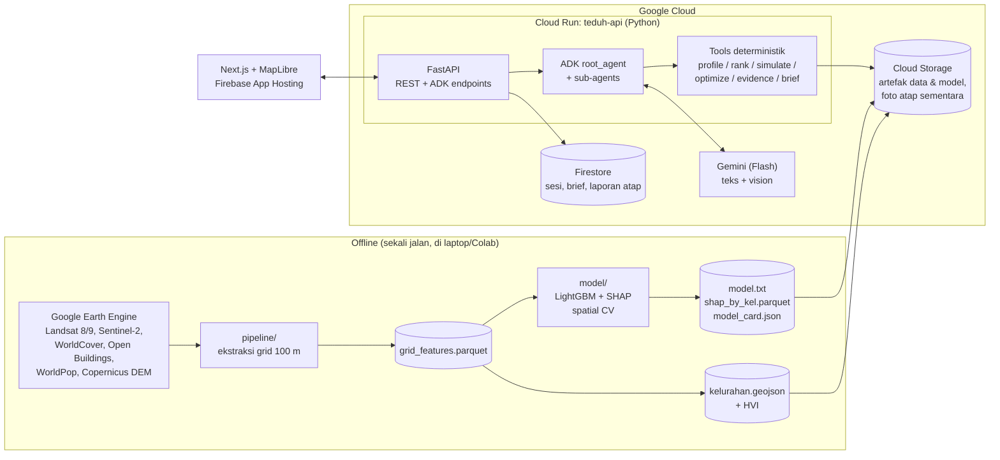

# TEDUH — Dokumen Konsep

> **AI agent yang membantu pemerintah kota memutuskan *di mana* dan *intervensi apa* untuk mendinginkan kawasan paling panas dan paling rentan, lalu menuliskannya menjadi rancangan kebijakan.**

| | |
|---|---|
| Kompetisi | AI Builder Cup 2026 (Hack2skill × Google Cloud) |
| Tema | Sustainability & Social Impact |
| Status | Konsep v0.1, 7 Oktober 2026 |
| Kota pilot | DKI Jakarta (desain siap diperluas ke Depok dan kota lain) |
| Batas submission | **18 Oktober 2026** (cek zona waktu di dashboard Hack2skill) |
| Batas registrasi & tim | **11 Oktober 2026** — tim wajib 2–4 orang |

---

## 1. Ringkasan

Jakarta mencatat intensitas Urban Heat Island (UHI) tertinggi di antara kota besar Indonesia yang diteliti, dengan puncak sekitar 8 °C di musim kemarau. Penelitian pemetaan UHI berbasis machine learning sudah banyak dan akurat, tetapi hasilnya jarang sampai ke dokumen perencanaan seperti RDTR, RPJMD, atau program kelurahan. Alat yang ada (simulasi CFD, optimasi NSGA-II, digital twin) terlalu teknis dan mahal untuk dinas di kota menengah.

**TEDUH** menjembatani celah itu. Perencana cukup bertanya dalam bahasa sehari-hari, misalnya *"Kelurahan mana di Jakarta Timur yang paling panas dan paling rentan, dan dengan anggaran Rp 2 miliar intervensi apa yang paling efektif?"* Agen Gemini kemudian:

1. menarik profil panas tiap kelurahan dari data satelit yang sudah diolah,
2. menghitung indeks kerentanan panas (bahaya × keterpaparan × kepekaan),
3. menjalankan simulasi skenario intervensi (pohon, cool roof, green roof) dengan model ML,
4. menyusun portofolio intervensi dalam batas anggaran,
5. menulis draf policy brief yang setiap angkanya bisa ditelusuri ke data atau literatur.

Warga juga bisa ikut lewat fitur **Cek Atap**: unggah foto atap rumah, lalu Gemini mengenali jenis atap dan merekomendasikan cool roof atau green roof sesuai temuan studi atap tropis Indonesia.

---

## 2. Konteks Kompetisi dan Cara TEDUH Memenuhinya

### 2.1 Syarat wajib

| Syarat | Implementasi TEDUH |
|---|---|
| Model Google AI (Gemini atau Gemma) | Gemini Flash (`gemini-2.5-flash`) untuk agen dan vision. Model ID disimpan di env var (`TEDUH_MODEL`), cek ulang ketersediaannya di Vertex AI sebelum build. |
| Platform agentic: Agent Platform, Antigravity, atau AI Studio | **Agent Development Kit (ADK)** sebagai bagian dari Gemini Enterprise Agent Platform. Prototipe prompt di AI Studio. Antigravity boleh dipakai sebagai IDE. |
| Deploy di Cloud Run atau Firebase | Backend agen + API di **Cloud Run**. Frontend Next.js di **Firebase App Hosting** atau Cloud Run. |
| Proyek baru selama hackathon | Repo dibuat dari nol mulai 8 Okt 2026. Literatur dan data publik boleh dipakai. |

### 2.2 Deliverable submission

1. **Proposal PDF**: masalah, visi solusi, manfaat bagi warga, kelayakan, potensi skala.
2. **Prototipe berfungsi** dengan URL publik di Cloud Run/Firebase.
3. **Video demo maksimal 3 menit** (YouTube/Vimeo/Drive, publik).
4. **Kategori**: Sustainability & Social Impact.

### 2.3 Pemetaan ke kriteria penilaian

| Kriteria (bobot) | Yang ditunjukkan TEDUH |
|---|---|
| **Technical Merit & Gen AI (40%)** | Agen ADK dengan beberapa sub-agen dan tool deterministik. Gemini vision untuk foto atap dengan output terstruktur. Pengecek asal-usul angka (*number provenance check*) sehingga brief tidak berisi angka karangan. Deploy serverless yang bisa diskalakan. |
| **Problem Alignment & Impact (25%)** | Menjawab celah yang disebut literatur: hasil pemetaan tidak masuk kebijakan, alat terlalu teknis, intervensi tidak berpihak ke warga rentan. Output-nya dokumen yang benar-benar dipakai dinas. |
| **Innovation & Creativity (25%)** | Gabungan model ML panas, indeks keadilan panas, simulasi skenario, dan penulisan kebijakan dalam satu percakapan. Laporan warga lewat foto atap. |
| **UX & Solution Design (10%)** | Peta interaktif dan chat berdampingan, slider skenario, brief yang bisa diunduh, antarmuka berbahasa Indonesia. |

---

## 3. Masalah

### 3.1 Bukti dari literatur

Angka berikut diambil dari ringkasan NotebookLM "Pemetaan Pulau Panas Perkotaan Berbasis Pembelajaran Mesin" (43 sumber). **Cek ulang ke naskah aslinya sebelum dikutip di proposal.**

- **Skala masalah.** Jakarta: intensitas UHI permukaan rata-rata 3–6 °C, puncak sekitar 8 °C di musim kemarau. Surabaya 2–5 °C, Makassar sekitar 3 °C. *(Karurung et al., 2025 — ACRS; e-Journal Hamzanwadi)*
- **ML sudah akurat.** Random Forest untuk Jakarta mencapai R² 0,923 (RMSE 0,542 °C). LightGBM untuk Surabaya R² 0,951. Faktor dominan menurut SHAP: curah hujan, CO, kepadatan penduduk, kecepatan angin, NO₂. *(Karurung et al., 2025)*
- **Intervensi bisa diukur dengan model.** Di Kuala Lumpur, simulasi RF menunjukkan kenaikan NDVI 25% menurunkan LST antara −1,4 dan 0,1 °C, dan kenaikan albedo 25% menurunkan −1,2 sampai 0,1 °C. *(Miniandi et al., 2025)*
- **Celah implementasi.** Ada jarak antara peta termal resolusi tinggi buatan akademisi dan pemakaiannya di RDTR atau aturan bangunan. Pendanaan, pemeliharaan, dan koordinasi antarlembaga juga terfragmentasi. *(Kumar & Bassill, 2026; review MDPI tentang teknologi riset UHI)*
- **Alat terlalu teknis.** Optimasi spasial butuh keahlian Rhino-Grasshopper, Python, dan algoritma genetika, sehingga sulit dipakai perencana tanpa kalkulator berbasis web. Digital twin seperti Cooling Singapore memerlukan biaya tinggi dan platform tertutup. *(Computational Intelligence in Urban Microclimate Management; Huelva UDT, MDPI)*
- **Ketidakadilan panas.** Warga berpenghasilan rendah dan permukiman padat paling terpapar, sementara kelompok lansia, anak-anak, dan pekerja luar ruang paling berisiko. Literatur menyarankan intervensi diprioritaskan ke wilayah rentan, bukan disebar merata. *(Urban heat dynamics in the tropical global south, ICES 2025)*
- **Kurang partisipasi warga.** Data UHI jarang disajikan dalam bentuk yang mudah dipahami publik, dan warga jarang dilibatkan. *(Kumar & Bassill, 2026)*

### 3.2 Rumusan masalah

> Dinas di kota-kota Indonesia tidak punya alat yang mudah dan murah untuk mengubah data panas perkotaan menjadi keputusan intervensi yang berpihak pada warga rentan dan bisa dipertanggungjawabkan dalam dokumen kebijakan.

---

## 4. Pengguna

| Persona | Kebutuhan | Fitur utama |
|---|---|---|
| **Perencana Bappeda / Dinas Cipta Karya / DLH** | Menentukan lokasi prioritas dan jenis intervensi, menyusun justifikasi anggaran. | Peta prioritas, simulasi skenario, portofolio anggaran, policy brief. |
| **Lurah / Camat / fasilitator kelurahan** | Mengusulkan program penghijauan dalam Musrenbang dengan data. | Profil kelurahan, ringkasan dalam bahasa sederhana. |
| **Warga** | Tahu cara mendinginkan rumah dengan biaya wajar. | Cek Atap (foto → rekomendasi). |
| **Peneliti / analis kebijakan** | Menelusuri asal angka dan metode. | Panel bukti, model card, unduh data. |

Persona utama untuk demo adalah **perencana dinas**. Persona warga melengkapi narasi dampak sosial.

---

## 5. Solusi

### 5.1 Lingkup fitur

**P0 — wajib ada di demo**

1. **Peta Panas & Kerentanan.** Choropleth kelurahan Jakarta dengan lapisan: LST rata-rata musim kemarau, anomali terhadap rata-rata kota, Heat Vulnerability Index (HVI), NDVI, tutupan bangunan, kepadatan penduduk.
2. **Chat agen (Bahasa Indonesia).** Menjawab pertanyaan, memanggil tool, dan menyorot kelurahan terkait di peta.
3. **Profil Kelurahan.** Nilai panas, peringkat, faktor pendorong utama (SHAP), dan jumlah warga rentan.
4. **Simulasi Skenario.** Pilih intervensi dan intensitasnya, lihat perkiraan ΔLST dari model beserta rentang dari literatur.
5. **Portofolio Anggaran.** Input anggaran dan wilayah, output daftar paket (kelurahan × intervensi) yang memaksimalkan penurunan panas tertimbang jumlah warga rentan per rupiah.
6. **Policy Brief.** Draf terstruktur (Markdown → PDF) dengan sitasi. Setiap angka diberi penanda sumbernya.
7. **Cek Atap.** Unggah foto, Gemini mengklasifikasi atap, lalu sistem memberi rekomendasi berbasis aturan dan bukti.

**P1 — kalau waktu cukup**

- Optimasi multi-objektif (NSGA-II via `pymoo`) dengan Pareto front: biaya vs penurunan panas vs pemerataan.
- Peta laporan warga (hasil Cek Atap ditampilkan anonim sebagai titik).
- Perbandingan sebelum/sesudah skenario dalam split-map.
- Ekspor brief ke Google Docs.

**P2 — roadmap, bukan untuk hackathon**

- Laporan panas warga sebagai data lapangan untuk mengoreksi data satelit.
- Cool pavement dengan data jaringan jalan OSM.
- Peramalan musiman dan peringatan panas untuk kader posyandu.
- Multi-kota (Depok, Surabaya, Makassar) dengan transfer learning.
- Surrogate berbasis PINN untuk suhu udara di tingkat pejalan kaki.

### 5.2 Yang sengaja tidak dikerjakan

- Bukan pengganti simulasi CFD/ENVI-met. Hasil simulasi TEDUH bersifat **indikatif** untuk penyaringan awal.
- Model memprediksi **suhu permukaan (LST)**, bukan suhu udara yang dirasakan warga. Batas ini ditampilkan di UI.
- Tidak membuat angka biaya sendiri. Biaya satuan adalah asumsi yang bisa diedit dan diberi label.

---

## 6. Arsitektur

### 6.1 Gambaran umum



### 6.2 Prinsip desain

1. **Gemini tidak menghitung angka.** Semua angka berasal dari tool Python yang deterministik. Gemini memilih tool, merangkai penalaran, dan menulis narasi.
2. **Setiap angka punya asal-usul.** Tool mengembalikan `facts` dengan ID. Brief memakai penanda `[[F:id]]` yang dirender jadi angka plus catatan kaki. Validator menolak brief yang berisi angka tanpa penanda (lihat §8.4).
3. **Data diolah di depan, aplikasi ringan.** Earth Engine tidak dipanggil saat runtime. Semua fitur dihitung sekali, disimpan sebagai Parquet/GeoJSON (perkiraan < 50 MB), lalu dimuat ke memori Cloud Run. Demo jadi cepat dan stabil.
4. **Jujur soal ketidakpastian.** Hasil model selalu ditampilkan bersama rentang literatur dan label "indikatif".
5. **Bahasa Indonesia lebih dulu.** UI dan jawaban agen dalam Bahasa Indonesia. Bahasa Inggris tersedia untuk juri (toggle).

---

## 7. Data dan Model

### 7.1 Wilayah dan unit analisis

- **Wilayah:** DKI Jakarta daratan (tanpa Kepulauan Seribu).
- **Grid:** 100 m × 100 m, sejajar dengan grid WorldPop. Perkiraan ~66 ribu sel.
- **Unit kebijakan:** kelurahan (~267). Nilai sel diagregasi ke kelurahan (rata-rata tertimbang luas, dan tertimbang penduduk untuk metrik paparan).
- **Batas administrasi:** HDX COD-AB Indonesia level 4 (P-code BPS, CC BY-IGO). Pemprov DKI dan BIG sebagai cadangan. Lihat `docs/DATA_SOURCES.md` §B dan `docs/DECISIONS.md`.

### 7.2 Dataset (Earth Engine)

| Variabel | Dataset (EE ID) | Resolusi | Olahan |
|---|---|---|---|
| LST (target) | `LANDSAT/LC08/C02/T1_L2`, `LANDSAT/LC09/C02/T1_L2` | 30 m (TIRS di-resample) | `ST_B10 × 0.00341802 + 149.0` → K → °C. Mask awan pakai `QA_PIXEL`. Median musim kemarau Jun–Sep 2023–2025. |
| Albedo | Landsat 8/9 SR (band yang sama) | 30 m | SR `× 0.0000275 − 0.2`, albedo broadband formula Liang (2001). |
| NDVI, NDBI, NDWI | `COPERNICUS/S2_SR_HARMONIZED` + `GOOGLE/CLOUD_SCORE_PLUS/V1/S2_HARMONIZED` | 10 m | Median periode yang sama dengan LST. |
| Fraksi pohon, bangunan, air | `ESA/WorldCover/v200` | 10 m | Persentase tiap kelas per sel 100 m. |
| Tinggi & kepadatan bangunan | `GOOGLE/Research/open-buildings-temporal/v1` (tahun 2023) | 4 m efektif | Rata-rata `building_height`, fraksi `building_presence > 0.5` sebagai fraksi atap. |
| Penduduk | `projects/sat-io/open-datasets/WORLDPOP/pop` (2025) | 100 m | Jumlah jiwa per sel. Fallback `WorldPop/GP/100m/pop` (2020). |
| Penduduk rentan | `projects/sat-io/open-datasets/WORLDPOP/agesex` (2025) | 100 m | Jumlah usia < 5 dan ≥ 65. |
| Elevasi | `COPERNICUS/DEM/GLO30` | 30 m | Rata-rata per sel. |
| Jarak ke pantai | turunan dari mask air/garis pantai | — | Kilometer. |
| NO₂ (opsional) | `COPERNICUS/S5P/OFFL/L3_NO2` | ~1 km | Hanya sebagai kovariat konteks. |

> Katalog lengkap (lisensi, sitasi, data validasi, harga satuan, foto uji): `docs/DATA_SOURCES.md`.

> Catatan: Karurung et al. memakai panel bulanan sehingga curah hujan dan polutan dominan. TEDUH memakai **penampang spasial** satu musim, jadi pendorongnya akan didominasi faktor permukaan yang **bisa diintervensi**. Ini sengaja, karena tujuannya adalah keputusan tata ruang.

Output pipeline: `data/processed/grid_features.parquet` dengan kolom `cell_id, kel_id, geometry (centroid), lst_c, albedo, ndvi, ndbi, ndwi, tree_frac, built_frac, water_frac, roof_frac, bldg_h_mean, pop, pop_u5, pop_65p, elev_m, dist_coast_km, no2`.

### 7.3 Model panas

- **Algoritma:** LightGBM regression. Baseline: regresi linear.
- **Fitur:** `albedo, ndvi, ndbi, ndwi, tree_frac, built_frac, water_frac, roof_frac, bldg_h_mean, elev_m, dist_coast_km` (+ `pop` sebagai proxy panas antropogenik). **Jangan** pakai koordinat lat/lon sebagai fitur.
- **Monotonic constraints** (pengetahuan fisika yang sederhana): LST turun saat `ndvi`, `albedo`, `tree_frac`, `water_frac` naik. LST naik saat `built_frac` dan `ndbi` naik. Hasilnya, simulasi skenario selalu searah dengan fisika. Ini versi ringan dari ide physics-informed ML di literatur.
- **Validasi:** spatial block cross-validation (blok 1 km, `GroupKFold` 5 lipatan) agar tidak bocor karena autokorelasi spasial. Laporkan R², RMSE, MAE per lipatan.
- **Target realistis:** R² ≥ 0,75 pada spatial CV. Jangan menjanjikan 0,92 seperti di paper karena desainnya berbeda.
- **Penjelasan:** SHAP `TreeExplainer`. Simpan SHAP per sel dan rata-ratanya per kelurahan (`shap_by_kel.parquet`) untuk fitur "faktor pendorong".
- **Model card:** `model_card.json` berisi periode data, metrik CV, fitur, batasan, versi. Ditampilkan di UI.

### 7.4 Heat Vulnerability Index (HVI)

Kerangka risiko IPCC: bahaya × keterpaparan × kerentanan. Semua komponen dinormalisasi ke persentil (0–1) dalam kota.

| Komponen | Simbol | Rumus |
|---|---|---|
| Bahaya | H | persentil `lst_c` |
| Keterpaparan | E | persentil kepadatan `pop` |
| Kepekaan | S | persentil `(pop_u5 + pop_65p) / pop` |
| Kurangnya kapasitas adaptif | A | `1 −` persentil `tree_frac` |

`HVI = H × (wE·E + wS·S + wA·A)`, bobot default `wE=0,4; wS=0,3; wA=0,3`, bisa diubah dari UI dan dicatat di brief.

Metrik pendamping: **warga rentan terpapar** = jumlah `pop_u5 + pop_65p` di sel dengan H ≥ 0,8.

### 7.5 Mesin skenario

Intervensi diterjemahkan menjadi perubahan fitur, lalu model memprediksi LST baru. Semua konstanta ada di `config/scenario.yaml` dan diberi label sumber atau "ASUMSI".

| Intervensi | Parameter | Perubahan fitur |
|---|---|---|
| `tree_planting` | `canopy_increase_pp` (poin persen luas sel), dibatasi lahan non-bangunan non-air | `tree_frac += Δ`; `ndvi += Δ × (ndvi_tree − ndvi)` dengan `ndvi_tree` = median NDVI sel yang `tree_frac > 0,8` (kalibrasi dari data) |
| `cool_roof` | `adoption_rate` (porsi luas atap) | `albedo += roof_frac × adoption × (α_cool − α_roof)`; default `α_cool = 0,65` (setelah penuaan), `α_roof = 0,15` — ASUMSI, cek literatur |
| `green_roof` | `adoption_rate` pada porsi atap datar (`flat_roof_share` default 0,2 — ASUMSI) | `ndvi` naik pada porsi atap tersebut, `albedo` mendekati 0,2 |

Output per kelurahan: ΔLST rata-rata, ΔLST tertimbang penduduk, jumlah warga rentan yang berada di sel dengan ΔLST ≤ −0,5 °C, luas intervensi (m²), dan biaya. Jika fitur hasil skenario melewati persentil 99 data latih, beri flag `extrapolation: true`.

**Pembanding literatur** selalu disertakan dari basis bukti (§7.7). Contoh: model memprediksi −0,8 °C, literatur Kuala Lumpur untuk +25% NDVI menyebut −1,4 sampai 0,1 °C.

### 7.6 Optimasi portofolio

- **Kandidat:** (kelurahan × intervensi × level rendah/sedang/tinggi).
- **Nilai:** `Σ (pop_u5 + pop_65p + λ·pop) × (−ΔLST)` per kandidat.
- **Biaya:** luas × harga satuan dari `config/costs.yaml`. Semua harga berlabel **ASUMSI** sampai diisi dari HSPK/SSH DKI atau penawaran vendor.
- **Solver:** Google **OR-Tools CP-SAT** (knapsack berganda). Kendala: anggaran total, maksimal satu level per (kelurahan, intervensi), dan **kendala keadilan** — minimal X% anggaran untuk kelurahan kuintil HVI teratas (default 60%).
- **P1:** NSGA-II (`pymoo`) untuk Pareto front biaya vs pendinginan vs pemerataan.

### 7.7 Basis bukti intervensi

Disimpan di `data/evidence/interventions.json`. Setiap entri: `id, intervention, metric, value_min, value_max, unit, context (lokasi, iklim, tipe bangunan), source_title, year, url_or_doi, verified (bool)`. Entri awal dari notebook (status `verified: false` sampai dicek ke naskah asli):

| Intervensi | Temuan | Sumber |
|---|---|---|
| Penghijauan (NDVI +25%) | LST −1,4 s.d. 0,1 °C | Miniandi et al. 2025, Kuala Lumpur |
| Albedo +25% | LST −1,2 s.d. 0,1 °C | Miniandi et al. 2025, Kuala Lumpur |
| Cool roof | Suhu turun hingga 11,58 °C; fluks panas −95%; hemat energi 36–55%. Cocok untuk atap miring/genteng. Lebih efektif malam hari. Reflektivitas turun karena debu. | Studi cool roof vs green roof tropis Indonesia (Journal UII) |
| Green roof | Suhu turun hingga 13,14 °C; fluks panas −91%; hemat energi ~60%. Cocok untuk atap beton datar. Efektif siang hari. | Journal UII |
| Cool pavement / heat-reflective coating | Permukaan jalan −9 s.d. >10 °C; UHI lingkungan −0,5 s.d. 1 °C | SNTI 2026; ICES 2025 (review Asia Tenggara) |
| Penghijauan kota (meta) | Suhu udara −1,5 s.d. 4,5 °C | Review dalam notebook |
| Green curtain | Suhu ruang −5 °C; memotong 80% sinar | The Use of Greenery to Combat Urban Warming in Tokyo |
| Paket intervensi terkoordinasi | Hotspot −7 °C; energi pendinginan −8% | Cooling Singapore DUCT |
| Keragaman pohon | Aturan 5-10-20 (spesies-genus-famili) | Urban Forest Diversity Guidelines (Melbourne) |
| Spesies pohon lokal | *Pterocarpus indicus*, *Swietenia macrophylla*, *Samanea saman* memberi efek pendinginan signifikan (Bandung) | Disebut di notebook, sumber persisnya perlu dilacak |

---

## 8. Desain Agen (ADK)

### 8.1 Struktur agen

```
teduh_coordinator  (root_agent, LlmAgent, Gemini Flash)
├── heat_analyst          → find_area, get_area_profile, rank_priority_areas, explain_drivers
├── intervention_planner  → simulate_intervention, optimize_portfolio, get_evidence
├── policy_writer         → get_session_facts, render_policy_brief
└── roof_inspector        → analyze_roof_photo, recommend_roof_action
```

Fallback kalau routing multi-agen tidak stabil: satu `LlmAgent` dengan semua tool. Desain tool tidak berubah.

### 8.2 Kontrak tool

Semua tool berupa fungsi Python bertipe dengan docstring jelas (ADK memakai docstring sebagai deskripsi tool). Semua mengembalikan `dict` dengan kunci `facts: list[Fact]` dan `map_highlight: list[kel_id]` (opsional) untuk menyorot peta.

```python
Fact = {"id": str, "label": str, "value": float | int | str, "unit": str,
        "source": "data:grid_features@v1" | "model:lgbm@v1" | "evidence:<id>" | "assumption:<key>"}
```

| Tool | Input | Output utama |
|---|---|---|
| `find_area(query: str)` | nama kelurahan/kecamatan/kota (fuzzy) | daftar `kel_id`, nama, kecamatan, kota |
| `get_area_profile(kel_id: str)` | — | LST rata-rata, anomali, peringkat, HVI dan komponennya, NDVI, fraksi pohon/bangunan, penduduk, warga rentan |
| `rank_priority_areas(scope: str, top_k: int = 10, weights: dict \| None = None)` | scope = kota/kecamatan/"all" | daftar kelurahan urut HVI + alasan singkat |
| `explain_drivers(kel_id: str)` | — | 3–5 fitur SHAP teratas dengan arah dan besarnya (°C) |
| `simulate_intervention(kel_ids: list[str], interventions: list[{type, level \| params}])` | — | ΔLST per kelurahan, ΔLST tertimbang penduduk, warga rentan terdampak, luas, biaya, `extrapolation`, rentang literatur |
| `optimize_portfolio(scope: str, budget_idr: int, equity_share: float = 0.6, allowed: list[str] \| None = None)` | — | daftar paket terpilih, total biaya, total ΔLST tertimbang, porsi untuk kuintil HVI teratas |
| `get_evidence(intervention: str)` | — | entri basis bukti dengan sitasi |
| `analyze_roof_photo(image_uri: str)` | foto di GCS | JSON terstruktur dari Gemini vision (§8.5) |
| `recommend_roof_action(roof: dict)` | output tool di atas | rekomendasi berbasis aturan + bukti + catatan keselamatan |
| `get_session_facts()` | — | semua `facts` yang sudah muncul di sesi |
| `render_policy_brief(draft_markdown: str)` | draf dengan penanda `[[F:id]]` | brief final (Markdown + PDF) atau daftar error validasi |

### 8.3 Instruksi sistem (inti)

- Jawab dalam Bahasa Indonesia yang jelas untuk pegawai pemerintah daerah, kecuali pengguna memakai bahasa lain.
- **Jangan pernah menulis angka yang tidak berasal dari hasil tool.** Kalau data tidak ada, katakan tidak ada.
- Selalu sebut bahwa ΔLST adalah suhu permukaan dan bersifat indikatif.
- Saat merekomendasikan intervensi, sertakan rentang literatur dari `get_evidence`.
- Prioritaskan warga rentan. Jika pengguna meminta prioritas yang mengabaikan keadilan, tetap tampilkan dampaknya terhadap kelompok rentan.
- Jangan membuat harga. Pakai `config/costs.yaml` dan sebut bahwa itu asumsi.

### 8.4 Pengecek asal-usul angka (number provenance check)

1. `policy_writer` menulis draf dengan penanda, contoh: `Kelurahan Kampung Melayu memiliki LST rata-rata [[F:kel_3175031001.lst]].`
2. `render_policy_brief` mengganti penanda dengan nilai + satuan dan membuat catatan kaki sumber.
3. Validator regex mencari angka di teks **di luar** penanda. Pengecualian: tahun (19xx/20xx), nomor bagian, nomor peraturan dalam daftar putih. Kalau ada angka liar, tool mengembalikan error dan agen menulis ulang (maksimal 2 kali).
4. UI menampilkan lencana "Semua angka terverifikasi (n fakta)". Ini poin jual untuk juri dan pengguna pemerintah.

Struktur brief: Ringkasan Eksekutif · Kondisi Panas Wilayah · Kelompok Rentan · Opsi Intervensi & Perkiraan Dampak · Rekomendasi Portofolio & Anggaran · Keterkaitan dengan Dokumen Perencanaan (RDTR/RPJMD/RTH 30%) · Keterbatasan · Sumber.

### 8.5 Cek Atap (Gemini vision)

`analyze_roof_photo` memanggil Gemini dengan `response_schema`:

```json
{
  "roof_visible": true,
  "roof_form": "flat | pitched | mixed | unknown",
  "material": "clay_tile | concrete_tile | metal_sheet | concrete_slab | asbestos_cement | other | unknown",
  "color_tone": "light | medium | dark",
  "condition": "good | worn | damaged | unknown",
  "shade_from_trees": "none | partial | heavy",
  "confidence": 0.0,
  "notes": "string"
}
```

Aturan `recommend_roof_action` (tidak memakai LLM):

| Kondisi | Rekomendasi |
|---|---|
| `pitched` + genteng/metal | Cat cool roof (pemantul panas). Prioritas tinggi untuk metal gelap. |
| `flat` + `concrete_slab` | Green roof jika struktur memungkinkan (sarankan cek beban ke tenaga ahli), atau cat cool roof. |
| `asbestos_cement` | **Jangan diamplas, dipotong, atau dibor.** Sarankan konsultasi tenaga profesional. Opsi aman: peneduh pohon atau green curtain. |
| `shade_from_trees: heavy` | Manfaat tambahan kecil. Sarankan menjaga pohon yang ada. |
| `confidence < 0,6` atau `roof_visible: false` | Minta foto ulang dengan panduan sudut. |

Privasi: hapus EXIF sebelum disimpan, lokasi hanya sampai tingkat kelurahan (opsional, atas persetujuan), foto dihapus otomatis dari GCS setelah 30 hari (lifecycle rule).

---

## 9. Pengalaman Pengguna

### 9.1 Tata letak

```
┌──────────────────────────────────────────────────────────────────────┐
│ TEDUH  │ Lapisan: [LST] [HVI] [NDVI] [Penduduk rentan]   │ ID/EN │ ⓘ │
├───────────────────────────────────────────┬──────────────────────────┤
│                                           │  Chat agen               │
│            PETA (MapLibre)                │  ─────────────────────   │
│   choropleth kelurahan, sorotan dari      │  pesan + kartu hasil     │
│   agen, klik → panel profil               │  (profil, skenario,      │
│                                           │   portofolio, brief)     │
├───────────────────────────────────────────┤                          │
│ Panel skenario: [Pohon ▮▮▯] [Cool roof ▮▯▯]│  [ketik pertanyaan…] 📎 │
│ [Green roof ▯▯▯]  Anggaran: Rp ____        │                          │
└───────────────────────────────────────────┴──────────────────────────┘
```

- Mobile: peta di atas, chat sebagai bottom sheet. Cek Atap punya halaman sendiri (`/cek-atap`) yang ramah ponsel.
- Kartu hasil di chat bisa diklik untuk menyorot peta.
- Setiap angka di kartu punya tooltip sumber.
- Tombol "Unduh brief (PDF)" dan "Salin ringkasan".

### 9.2 Contoh percakapan

> **Pengguna:** Kelurahan mana di Jakarta Timur yang paling perlu diprioritaskan untuk penanganan panas?
>
> **TEDUH:** *(memanggil `rank_priority_areas`)* Lima kelurahan dengan HVI tertinggi … *(peta menyorot 5 kelurahan)* Faktor utamanya adalah fraksi bangunan tinggi dan tutupan pohon rendah *(memanggil `explain_drivers`)* …
>
> **Pengguna:** Kalau di dua teratas kita lakukan cool roof 50% dan tambah kanopi 10%, turun berapa?
>
> **TEDUH:** *(memanggil `simulate_intervention` + `get_evidence`)* Perkiraan model … Sebagai pembanding, studi di Kuala Lumpur …
>
> **Pengguna:** Anggaran kami Rp 2 miliar. Susun paketnya dan buatkan brief untuk Bappeda.
>
> **TEDUH:** *(memanggil `optimize_portfolio` → `render_policy_brief`)* Brief siap. Semua 23 angka terverifikasi. [Unduh PDF]

---

## 10. Naskah Video Demo (≤ 3 menit)

| Waktu | Adegan | Pesan |
|---|---|---|
| 0:00–0:20 | Foto jalan Jakarta siang hari, peta LST | "Jakarta bisa 8 °C lebih panas dari pinggirannya. Peta panasnya sudah ada. Kebijakannya belum." |
| 0:20–0:50 | Tanya kelurahan prioritas di Jakarta Timur, peta menyorot | Agen memahami pertanyaan biasa dan memakai data satelit. |
| 0:50–1:30 | Faktor pendorong (SHAP), simulasi cool roof + pohon, rentang literatur | Bisa dijelaskan, bisa disimulasikan, jujur soal ketidakpastian. |
| 1:30–2:00 | Optimasi anggaran Rp 2 M dengan kendala keadilan | Anggaran diarahkan ke warga paling rentan. |
| 2:00–2:25 | Policy brief, lencana "angka terverifikasi", unduh PDF | Dari data ke dokumen kebijakan dalam hitungan menit, tanpa angka karangan. |
| 2:25–2:45 | Warga memotret atap di ponsel, keluar rekomendasi | Warga ikut terlibat. |
| 2:45–3:00 | Diagram arsitektur: Gemini, ADK, Cloud Run, Earth Engine, OR-Tools | Bisa diterapkan di kota lain cukup dengan mengganti batas wilayah. |

---

## 11. Stack dan Struktur Repo

### 11.1 Stack

| Lapisan | Pilihan |
|---|---|
| Data | Earth Engine Python API, geopandas, pyarrow |
| ML | LightGBM, SHAP, scikit-learn (CV), OR-Tools CP-SAT, pymoo (P1) |
| Agen | `google-adk` (Python), `google-genai`, Gemini Flash |
| Backend | Python 3.12, FastAPI (via `google.adk.cli.fast_api.get_fast_api_app` + router sendiri), uv |
| PDF | Markdown → HTML → WeasyPrint (paket sistem dipasang di Dockerfile) |
| Frontend | Next.js (App Router) + TypeScript + Tailwind + MapLibre GL JS, basemap gratis (mis. OpenFreeMap) dengan atribusi |
| Penyimpanan | Cloud Storage (artefak, foto), Firestore (sesi ADK, brief, laporan atap) |
| Deploy | Cloud Run `teduh-api` (region terdekat, mis. `asia-southeast2`), Firebase App Hosting atau Cloud Run `teduh-web`. Secret Manager untuk kunci. |
| Lokasi model | Cek region yang mendukung model Gemini pilihan. Pakai endpoint `global` bila tersedia. |

Env var penting (sesuai dokumentasi ADK terbaru, cek ulang saat setup):

```bash
GOOGLE_CLOUD_PROJECT=...
GOOGLE_CLOUD_LOCATION=...
GOOGLE_GENAI_USE_ENTERPRISE=True   # dokumentasi lama: GOOGLE_GENAI_USE_VERTEXAI
TEDUH_MODEL=gemini-2.5-flash
TEDUH_DATA_URI=gs://<bucket>/teduh/v1/
```

### 11.2 Struktur repo

```
teduh/
├── CLAUDE.md
├── docs/
│   ├── CONCEPT.md            ← dokumen ini
│   ├── model_card.md
│   └── proposal/             ← sumber PDF proposal
├── config/
│   ├── scenario.yaml         ← konstanta skenario (berlabel sumber/ASUMSI)
│   ├── costs.yaml            ← harga satuan (ASUMSI sampai diisi)
│   └── hvi.yaml              ← bobot HVI default
├── pipeline/                 ← offline, Earth Engine
│   ├── gee_extract.py
│   ├── build_grid.py
│   └── aggregate_kelurahan.py
├── model/
│   ├── train.py              ← LightGBM + spatial CV + monotonic constraints
│   ├── explain.py            ← SHAP
│   └── scenario.py           ← mesin skenario (dipakai tool)
├── data/
│   ├── boundaries/           ← kelurahan.geojson
│   ├── processed/            ← grid_features.parquet, kelurahan_metrics.parquet (tidak di-commit jika besar)
│   └── evidence/interventions.json
├── teduh_agent/              ← paket ADK (agent.py berisi root_agent, __init__.py)
│   ├── agent.py
│   ├── sub_agents/
│   ├── tools/
│   │   ├── areas.py
│   │   ├── scenario_tools.py
│   │   ├── optimize.py
│   │   ├── evidence.py
│   │   ├── roof.py
│   │   └── brief.py          ← render + validator provenance
│   └── prompts/
├── api/
│   ├── main.py               ← FastAPI: get_fast_api_app + /api/* router
│   └── schemas.py
├── web/                      ← Next.js
├── infra/
│   ├── Dockerfile
│   ├── deploy_api.sh
│   └── firebase.json
└── tests/
    ├── test_scenario.py
    ├── test_provenance.py
    ├── test_optimize.py
    └── eval/golden_questions.yaml
```

### 11.3 Endpoint REST (di luar endpoint ADK)

| Method | Path | Fungsi |
|---|---|---|
| GET | `/api/kelurahan` | GeoJSON ringan + metrik untuk peta |
| GET | `/api/kelurahan/{kel_id}` | profil lengkap |
| POST | `/api/simulate` | skenario langsung dari slider (tanpa LLM) |
| POST | `/api/optimize` | portofolio langsung dari form |
| POST | `/api/roof` | unggah foto → analisis + rekomendasi |
| GET | `/api/brief/{brief_id}` | brief Markdown/PDF |
| GET | `/api/model-card` | metrik dan batasan model |

Chat memakai endpoint ADK (`/run_sse`) dengan streaming.

---

## 12. Rencana Kerja 11 Hari

Asumsi tim 3 orang. **A** = agen & backend (Syafiq), **B** = data & ML, **C** = frontend, desain, video. Jika hanya 2 orang, C dibagi ke A dan B dan P1 dihapus.

| Hari | Tanggal | A — Agen & Backend | B — Data & ML | C — Frontend & Konten |
|---|---|---|---|---|
| 1 | Kam 8 Okt | Proyek GCP, billing, repo, CI, kerangka ADK "hello tool" di Cloud Run | Akses Earth Engine, skrip LST + indeks untuk 1 kecamatan uji | Kerangka Next.js + MapLibre, desain wireframe |
| 2 | Jum 9 Okt | Tool `find_area`, `get_area_profile` dengan data dummy | Ekstraksi seluruh Jakarta, batas kelurahan | Peta choropleth dari GeoJSON dummy |
| 3 | Sab 10 Okt | API REST + skema | `grid_features.parquet` final, agregasi kelurahan, HVI | Panel profil kelurahan |
| 4 | **Min 11 Okt** | **Registrasi tim final di Hack2skill** · basis bukti JSON | Train LightGBM + spatial CV + SHAP, model card | Chat UI + streaming SSE |
| 5 | Sen 12 Okt | `simulate_intervention`, `rank_priority_areas`, `explain_drivers` | `model/scenario.py` + unit test arah fisika | Panel skenario (slider) |
| 6 | Sel 13 Okt | Sub-agen + instruksi sistem, `optimize_portfolio` (OR-Tools) | Kalibrasi konstanta skenario, cek ekstrapolasi | Kartu hasil + sorotan peta |
| 7 | Rab 14 Okt | `render_policy_brief` + validator provenance + PDF | Cek Atap: kumpulkan 30 foto uji berlabel | Halaman `/cek-atap` (mobile) |
| 8 | Kam 15 Okt | `analyze_roof_photo` + `recommend_roof_action` · deploy penuh ke Cloud Run | Golden questions (20) + skrip evaluasi | Integrasi semua fitur, toggle ID/EN |
| 9 | Jum 16 Okt | Perbaikan bug dari evaluasi, `min-instances=1`, cache | Isi angka di proposal dari model card | Polesan UI, aksesibilitas, mobile |
| 10 | Sab 17 Okt | Freeze fitur · uji akhir di URL publik | Proposal PDF | Rekam & edit video ≤ 3 menit |
| 11 | **Min 18 Okt** | **Submit pagi hari** (cadangan waktu untuk masalah unggah) | Cek tautan publik | Unggah video publik |

Titik keputusan:
- **Akhir hari 3:** kalau batas kelurahan bermasalah, pakai kecamatan atau grid 1 km.
- **Akhir hari 6:** kalau multi-agen tidak stabil, pindah ke satu agen.
- **Akhir hari 8:** fitur yang belum jalan dikeluarkan dari demo.

---

## 13. Evaluasi dan Pengujian

| Aspek | Cara ukur | Target |
|---|---|---|
| Model panas | Spatial block CV | R² ≥ 0,75; RMSE dilaporkan |
| Arah fisika skenario | Unit test: tambah pohon/albedo → ΔLST ≤ 0 | 100% lulus |
| Provenance | Semua brief di golden set | 100% lulus validator |
| Pemilihan tool | 20 golden questions, cek tool yang dipanggil | ≥ 90% benar |
| Cek Atap | 30 foto berlabel manual | akurasi `roof_form` ≥ 85%, `material` ≥ 70% |
| Latensi | p50 per jawaban chat | < 8 detik |
| Optimasi | Kendala anggaran & keadilan terpenuhi | 100% |

---

## 14. Risiko dan Mitigasi

| Risiko | Dampak | Mitigasi |
|---|---|---|
| Tim belum terbentuk sebelum 11 Okt | Tidak bisa ikut | Cari anggota hari ini (komunitas GDG, rekan kantor). Pendaftaran solo boleh lalu gabung tim. |
| Awan tebal di citra termal tropis | LST bolong | Median multi-tahun musim kemarau. Isi celah dengan interpolasi, tandai sel ber-kualitas rendah. |
| Ekspor Earth Engine lambat atau kuota | Pipeline molor | Mulai hari 1. Ekspor per kota administrasi. Simpan hasil antara. |
| Batas kelurahan tidak tersedia/tidak rapi | Unit kebijakan hilang | Fallback kecamatan atau grid 1 km. |
| Gemini mengarang angka | Kepercayaan hilang | Arsitektur tool deterministik + validator provenance. |
| Model korelasional dipakai sebagai kausal | Klaim berlebihan | Monotonic constraints, label "indikatif", pembanding literatur, flag ekstrapolasi. |
| Harga satuan tidak akurat | Portofolio menyesatkan | Semua harga berlabel ASUMSI dan bisa diedit. Cantumkan di brief. |
| Cold start Cloud Run saat dinilai | Kesan buruk | `min-instances=1` selama 19 Okt–6 Nov. Data kecil dimuat saat startup. |
| Biaya API membengkak saat penilaian | Tagihan | Model Flash, batas token per sesi, rate limit sederhana, anggaran billing alert. |
| Lisensi data | Masalah atribusi | Halaman "Sumber data" dengan atribusi WorldPop, ESA WorldCover, Google Open Buildings, Copernicus, USGS Landsat. |
| Foto atap memuat data pribadi | Privasi | Hapus EXIF, tidak menyimpan wajah/alamat, lifecycle 30 hari. |

---

## 15. Dampak dan Skala

- **Pengguna langsung:** Bappeda dan dinas teknis di 500+ kabupaten/kota Indonesia yang wajib menyusun RTH dan RDTR.
- **Penerima manfaat:** warga rentan di kawasan terpanas (lansia, balita, pekerja luar ruang).
- **Replikasi:** pipeline hanya butuh batas wilayah dan periode. Semua dataset global (Landsat, Sentinel, WorldCover, Open Buildings untuk Global South, WorldPop), sehingga bisa diterapkan di kota Asia Tenggara lain.
- **Jalur adopsi:** uji coba bersama satu Pemkot (misalnya Depok atau DKI) setelah hackathon. Brief bisa langsung dipakai sebagai lampiran usulan Musrenbang atau kajian teknis RTH.
- **Kaitan SDG:** SDG 11 (kota berkelanjutan), SDG 13 (aksi iklim), SDG 3 (kesehatan).

---

## 16. Checklist Submission

- [ ] Tim 2–4 orang terdaftar sebelum **11 Okt 2026**
- [ ] URL prototipe publik (Cloud Run/Firebase) bisa dibuka tanpa login
- [ ] Video ≤ 3 menit, publik, ada narasi atau teks
- [ ] Proposal PDF: masalah, solusi, manfaat warga, kelayakan, skala, arsitektur, tim
- [ ] Kategori: Sustainability & Social Impact
- [ ] Halaman "Tentang & Sumber Data" di aplikasi
- [ ] Model card dan batasan tercantum
- [ ] Semua angka literatur di proposal sudah dicek ke naskah asli
- [ ] Submit sebelum **18 Okt 2026** (pagi)

---

## 17. Pertanyaan Terbuka

1. Anggota tim dan pembagian peran final.
2. Kota pilot final: Jakarta (literatur paling kuat) atau Depok (lebih dekat dengan pemangku kepentingan)?
3. Sumber batas kelurahan yang paling rapi dan berlisensi jelas.
4. Harga satuan intervensi: ada akses ke HSPK/SSH DKI?
5. Gemini via Agent Platform (Vertex) atau API key AI Studio? Rekomendasi: Agent Platform agar cerita "Google Cloud" utuh.
6. Apakah ada mitra pemda/BRIN yang bisa memberi kutipan atau umpan balik untuk proposal?

---

## 18. Referensi

### Kompetisi
- AI Builder Cup 2026 — https://aibuildercup.com/ · tema: https://aibuildercup.com/themes.html · FAQ: https://aibuildercup.com/Faqs.html

### Teknis Google
- ADK deploy ke Cloud Run — https://adk.dev/deploy/cloud-run/
- Cloud Run + ADK — https://docs.cloud.google.com/run/docs/ai/build-and-deploy-ai-agents/adk
- Gemini API changelog (model ID) — https://ai.google.dev/gemini-api/docs/changelog
- Open Buildings Temporal v1 — https://developers.google.com/earth-engine/datasets/catalog/GOOGLE_Research_open-buildings-temporal_v1

### Literatur (dari notebook NotebookLM, cek ke naskah asli)
- Karurung et al. (2025). *Assessment of Urban Heat Island Intensity and Key Drivers in Three Major Indonesian Cities Using Machine Learning.* ACRS/AARS.
- Miniandi et al. (2025). *Machine Learning in Modeling Urban Heat Islands: A Data-Driven Approach for Kuala Lumpur.*
- Kong et al. (2025). *Modelling urban heat island effects: a global analysis of 216 cities using machine learning techniques.*
- Kumar & Bassill (2026). *Machine learning approaches to urban heat island detection and sustainability analysis.*
- *Towards a Sustainable Urban Future: A Comprehensive Review of Urban Heat Island Research Technologies and Machine Learning Approaches.* MDPI.
- *Urban heat dynamics in the tropical global south: remote sensing, modeling advances, and mitigation pathways from Southeast Asia (2019–2025).* ICES.
- *Urban heat island distribution, transformation, and projection (Case study: Jakarta City in 2000, 2020, and 2040).*
- *A Comparative Study of Cool Roof and Green Roof Performance in Tropical Area of Indonesia.* Journal UII.
- *Pengaruh Kondisi Permukaan Perkerasan terhadap Kinerja Pendinginan Heat-Reflective Coatings dalam Mitigasi Urban Heat Island.* SNTI 2026.
- *Exploring the effects of urban heat island: A case study of two cities in Thailand and Indonesia.* APN Science Bulletin.
- *Enhanced Urban Heat Island Modeling with Machine Learning and Regression Kriging in a Topographically Diverse Medium-Sized City.* MDPI.
- *Computational Intelligence in Urban Microclimate Management: PINNs, Spatial Optimization, and Digital Twins for UHI Mitigation.*
- *Physics-Informed Neural Networks for Urban and Building Thermal Environment Modeling: A Review.* MDPI.
- *An Open-Source Urban Digital Twin for Enhancing Outdoor Thermal Comfort in the City of Huelva (Spain).* MDPI.
- *Cooling Singapore — Digital Urban Climate Twin.* · *Strategies for cooling Singapore.* C40 Knowledge Hub.
- *Improving the Urban Thermal Environment in Chengdu: Multi-Objective Land-Use Optimization with NSGA-II.* MDPI.
- *Multi-objective planning model for urban greening based on optimization algorithms.*
- *Reducing Urban Heat Islands: Compendium of Strategies.* US EPA.
- *The Use of Greenery to Combat Urban Warming in Tokyo.*
- *Urban Forest Strategy* & *Urban Forest Diversity Guidelines* (City of Melbourne).

